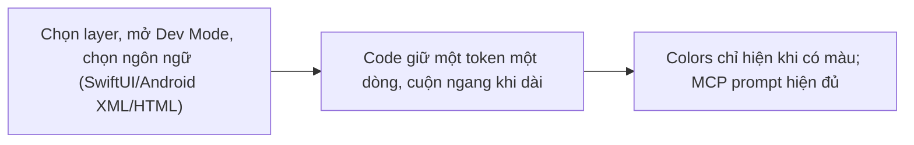
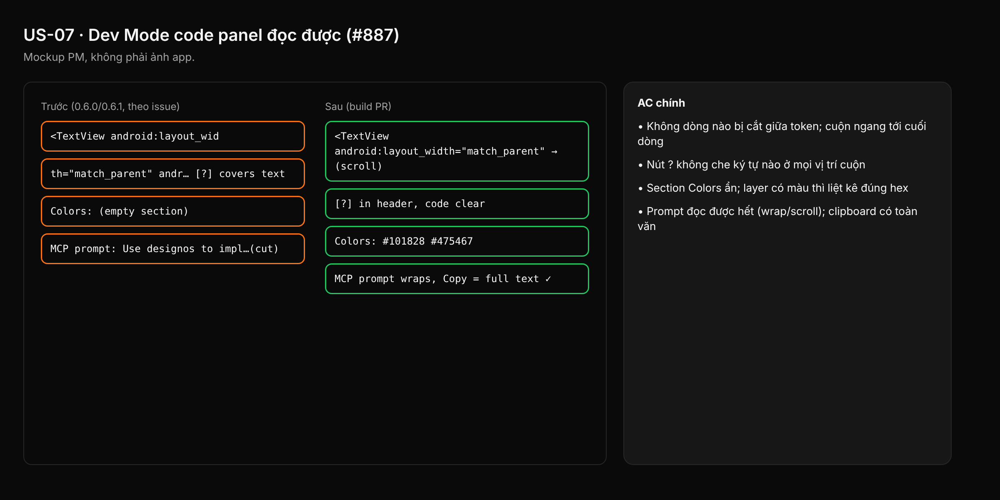

- Issue #887 · milestone v0.6.4 · trạng thái code 25/10: PR #1033 merged (0.6.2); còn xác minh QA U-02/U-10 trên tag

## 1. User Story
Là developer dùng Dev Mode, tôi muốn đọc code panel mà không bị ngắt dòng giữa token hay bị nút che, để copy code đúng.

## 2. Flow
| Bước | Hành động | Phản hồi |
|---|---|---|
| 1 | Chọn layer, mở Dev Mode, chọn ngôn ngữ (SwiftUI/Android XML/HTML) | Xem AC liên quan |
| 2 | Code giữ một token một dòng, cuộn ngang khi dài | Xem AC liên quan |
| 3 | Colors chỉ hiện khi có màu; MCP prompt hiện đủ | Xem AC liên quan |

## 3. Dữ liệu và quy tắc
- R1. Không ngắt dòng trong token; dòng dài cuộn ngang (white-space: pre / no-wrap).
- R2. Nút `?` nằm ngoài vùng text (header) hoặc vùng code chừa padding; không bao giờ che chữ.
- R3. Colors: liệt kê màu thực dùng; rỗng thì ẩn section.
- R4. MCP prompt trong inspector wrap hoặc cuộn, đọc được toàn bộ; Copy chép đủ.
- Nguồn QA: U-02, U-10, `b7-03-devmode-html.png`.

Dependency: PR #1033 merged.

## 4. Acceptance Criteria
| ID | Given | When | Then | Source |
|---|---|---|---|---|
| AC-01 | Layer có Android XML dài (>120 ký tự/dòng) | Mở code panel ở chiều rộng mặc định | Không dòng nào bị cắt giữa token; cuộn ngang tới cuối dòng | R1 |
| AC-02 | Code panel có nội dung | Rê chuột / cuộn tới góc có nút ? | Nút ? không che ký tự nào ở mọi vị trí cuộn | R2 |
| AC-03 | Layer không có màu (chỉ frame trống) | Mở Dev Mode | Section Colors ẩn; layer có màu thì liệt kê đúng hex | R3 |
| AC-04 | Inspector Dev Mode có MCP prompt | Xem và bấm Copy | Prompt đọc được hết (wrap/scroll); clipboard có toàn văn | R4 |
| AC-05 | Build tag v0.6.4, màn hình 1440 px | QA chạy lại U-02, U-10 (SwiftUI, XML, HTML) | Ảnh mới thay ui-02.png/b7-03 ghi vào issue | G5 |

Test steps: [tests/cases/US-07.md](../tests/cases/US-07.md). Mỗi fix: test đỏ trước trên main `d0555c8`, xanh sau.

## 5. Edge cases
- Panel kéo hẹp tối thiểu: vẫn không wrap, có scrollbar ngang.
- Dòng chứa emoji / CJK: không tách giữa grapheme.
- Theme sáng/tối: nút ? vẫn tương phản.
- Ngôn ngữ đổi khi đang cuộn: reset cuộn về đầu.
- Copy giữ nguyên xuống dòng gốc, không chèn soft wrap.

## 6. UI
Ảnh tham chiếu (mockup PM, không phải ảnh app): 

Bằng chứng thật bắt buộc trong PR: ảnh code panel 3 ngôn ngữ trên build tag.
