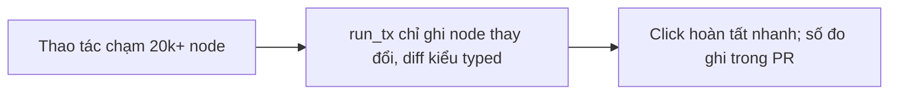
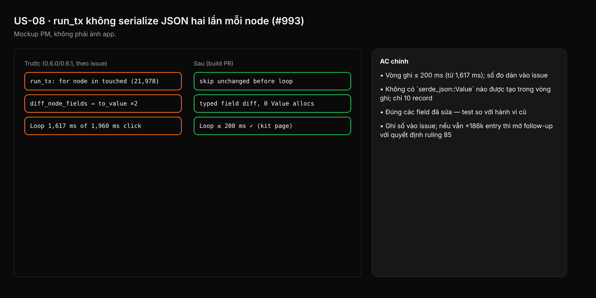

- Issue #993 · milestone v0.6.4 · trạng thái code 25/10: PR #1025 merged (0.6.2, typed diff); còn đo lại số trên kit/VSF và chốt câu hỏi user_edited_fields

## 1. User Story
Là designer sửa lớn (auto-fix palette, Fix all, paste cây lớn), tôi muốn thao tác không đứng hình cả giây vì ghi nhận thay đổi.

## 2. Flow
| Bước | Hành động | Phản hồi |
|---|---|---|
| 1 | Thao tác chạm 20k+ node | Xem AC liên quan |
| 2 | run_tx chỉ ghi node thay đổi, diff kiểu typed | Xem AC liên quan |
| 3 | Click hoàn tất nhanh; số đo ghi trong PR | Xem AC liên quan |

## 3. Dữ liệu và quy tắc
- Số gốc (#988 review): ~24 µs/node chạm, ~9 µs/node đổi; kit 21,978 node: 1,617/1,960 ms; VSF 84,751 node.
- R1. Node không đổi bị bỏ trước vòng ghi.
- R2. Diff field typed, không qua `serde_json::Value`.
- R3. `user_edited_fields` không phình vô hạn: ghi rõ nó cấp gì cho lượt agent kế (ruling 85) trước khi bỏ ghi khi không có agent turn.
- R4. Hành vi không đổi: lượt agent kế thấy cùng tập field user đã sửa.

Dependency: PR #1025. Bản copy kit + VSF trên máy dev (đo).

## 4. Acceptance Criteria
| ID | Given | When | Then | Source |
|---|---|---|---|---|
| AC-01 | Kit page 21,978 node, build tag | Auto-fix palette toàn page (#988) | Vòng ghi ≤ 200 ms (từ 1,617 ms); số đo dán vào issue | #993 |
| AC-02 | Transaction chạm 10,000 node, đổi 10 | Đếm allocation bằng counting allocator | Không có `serde_json::Value` nào được tạo trong vòng ghi; chỉ 10 record | R1,R2 |
| AC-03 | User sửa fill rồi agent turn mới | Agent đọc user_edited_fields | Đúng các field đã sửa — test so với hành vi cũ | R4 |
| AC-04 | 1 sửa toàn page trên VSF | Đo len(user_edited_fields) | Ghi số vào issue; nếu vẫn +186k entry thì mở follow-up với quyết định ruling 85 | R3 |

Test steps: [tests/cases/US-08.md](../tests/cases/US-08.md). Mỗi fix: test đỏ trước trên main `d0555c8`, xanh sau.

## 5. Edge cases
- Transaction rỗng: không ghi gì.
- Node bị xoá trong tx: ghi xoá, không diff field.
- Node mới: ghi toàn bộ field như cũ.
- Undo của sửa lớn: cùng chi phí, không ghi lại edited fields sai.
- Agent turn đang chạy giữa sửa: không mất field.

## 6. UI
Ảnh tham chiếu (mockup PM, không phải ảnh app): 

Bằng chứng thật bắt buộc trong PR: output test/terminal trên build PR.
