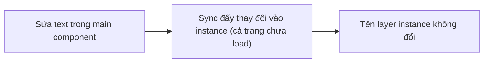
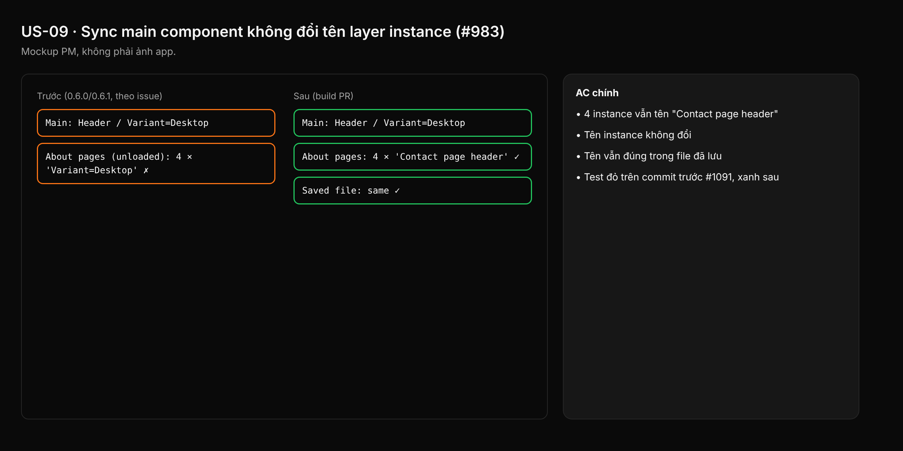

- Issue #983 · milestone v0.6.5 · trạng thái code 25/10: PR #1091 merged; còn xác minh trên kit (trang chưa load, đã load, file đã lưu)

## 1. User Story
Là designer sửa main component, tôi muốn instance giữ tên layer của chúng, để layer "Contact page header" không bị đổi thành tên variant.

## 2. Flow
| Bước | Hành động | Phản hồi |
|---|---|---|
| 1 | Sửa text trong main component | Xem AC liên quan |
| 2 | Sync đẩy thay đổi vào instance (cả trang chưa load) | Xem AC liên quan |
| 3 | Tên layer instance không đổi | Xem AC liên quan |

## 3. Dữ liệu và quy tắc
- R1. Sync main → instance không bao giờ ghi `name` của instance (name là của instance, không phải của main).
- R2. Áp dụng cho trang đã load và chưa load (lazy load), và cho file đã lưu.
- R3. Tên layer con bên trong instance: theo main trừ khi có override tên.

Dependency: PR #1091. Kit Untitled UI PRO VARIABLES v8.0, trang "About pages".

## 4. Acceptance Criteria
| ID | Given | When | Then | Source |
|---|---|---|---|---|
| AC-01 | Kit, trang About pages chưa load, 4 instance tên "Contact page header" | Sửa text trong main, rồi mở About pages | 4 instance vẫn tên "Contact page header" | #983 |
| AC-02 | Instance trên trang đã load | Sửa main | Tên instance không đổi | R2 |
| AC-03 | Sau AC-01 | Lưu, mở lại file | Tên vẫn đúng trong file đã lưu | R2 |
| AC-04 | Fixture 1 main + 1 instance tên khác (unit) | sync_main_into_instances | Test đỏ trên commit trước #1091, xanh sau | red-first |

Test steps: [tests/cases/US-09.md](../tests/cases/US-09.md). Mỗi fix: test đỏ trước trên main `d0555c8`, xanh sau.

## 5. Edge cases
- Instance đổi tên trùng tên main: vẫn giữ.
- Swap variant: tên instance vẫn giữ (Figma giữ).
- Instance lồng instance: mọi cấp giữ tên.
- Layer con có override tên: giữ override.
- Undo sửa main: không làm tên đổi.

## 6. UI
Ảnh tham chiếu (mockup PM, không phải ảnh app): 

Bằng chứng thật bắt buộc trong PR: ảnh layer panel About pages trên bản copy kit.
