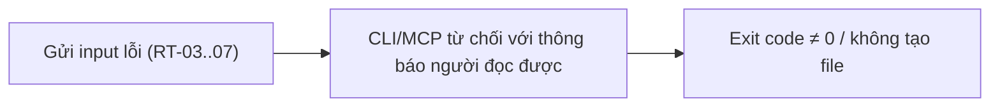
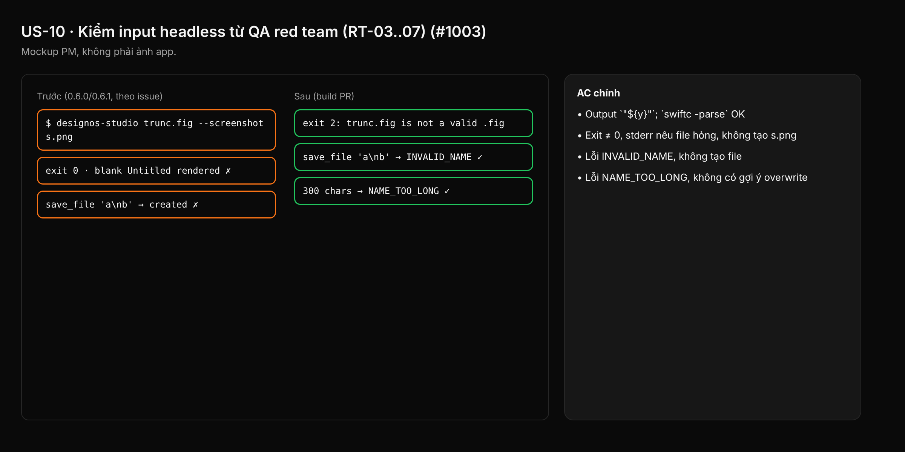

- Issue #1003 · milestone v0.6.5 · trạng thái code 25/10: RT-03 merged (#1090), RT-05/06 merged (#1103), RT-04/RT-07 trong PR #1117 (open)

## 1. User Story
Là người dùng CLI/MCP và agent, tôi muốn input lỗi bị từ chối rõ ràng với exit code đúng, để script không tưởng là thành công và tên file không giả mạo được.

## 2. Flow
| Bước | Hành động | Phản hồi |
|---|---|---|
| 1 | Gửi input lỗi (RT-03..07) | Xem AC liên quan |
| 2 | CLI/MCP từ chối với thông báo người đọc được | Xem AC liên quan |
| 3 | Exit code ≠ 0 / không tạo file | Xem AC liên quan |

## 3. Dữ liệu và quy tắc
| QA | Rule |
|---|---|
| RT-03 | Codegen SwiftUI escape `\(`… đúng Swift; `${y}` ra `"${y}"` và compile được. |
| RT-04 | `--screenshot` với .fig hỏng: exit ≠ 0, không render file Untitled trống. |
| RT-05 | `save_file` từ chối tên có ký tự điều khiển (\n) và bidi (U+202E…). |
| RT-06 | Tên > 255 byte: lỗi "name too long", không phải `FILE_EXISTS`. |
| RT-07 | `--apply-spec` children sai kiểu: "children must be an array of NodeSpec". |

Dependency: PR #1090, #1103 (merged); PR #1117 (open, không merge trong batch này).

## 4. Acceptance Criteria
| ID | Given | When | Then | Source |
|---|---|---|---|---|
| AC-01 | Text chứa `${y}` | `--codegen swiftui` | Output `"${y}"`; `swiftc -parse` OK | RT-03 |
| AC-02 | File `trunc.fig` cắt ngắn | `designos-studio trunc.fig --screenshot s.png` | Exit ≠ 0, stderr nêu file hỏng, không tạo s.png | RT-04 |
| AC-03 | MCP session | `save_file "a\nb.designos"` và tên có U+202E | Lỗi INVALID_NAME, không tạo file | RT-05 |
| AC-04 | Tên 300 ký tự, file chưa tồn tại | `save_file` | Lỗi NAME_TOO_LONG, không có gợi ý overwrite | RT-06 |
| AC-05 | Spec children là mảng của mảng | `--apply-spec` | Thông báo "children must be an array of NodeSpec" kèm path JSON | RT-07 |

Test steps: [tests/cases/US-10.md](../tests/cases/US-10.md). Mỗi fix: test đỏ trước trên main `d0555c8`, xanh sau.

## 5. Edge cases
- Tên chỉ có khoảng trắng: từ chối.
- Unicode hợp lệ (tiếng Việt, CJK) vẫn lưu được.
- Tên đúng 255 byte UTF-8: được.
- Fig rỗng 0 byte: như RT-04.
- Mỗi RT có test đỏ trước.

## 6. UI
Ảnh tham chiếu (mockup PM, không phải ảnh app): 

Bằng chứng thật bắt buộc trong PR: output test/terminal trên build PR.
