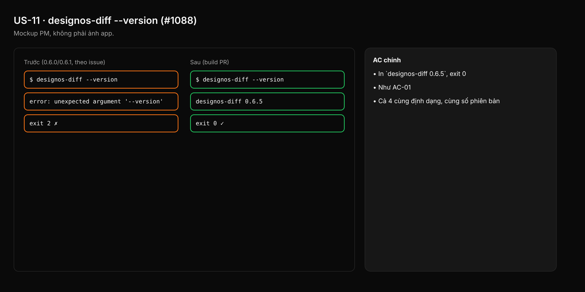

- Issue #1088 · milestone v0.6.5 · trạng thái code 25/10: PR #1090 merged; còn xác minh binary trong bundle tag

## 1. User Story
Là người dùng CLI, tôi muốn `designos-diff --version` in phiên bản như ba binary kia, để báo lỗi kèm phiên bản.

## 2. Flow
| Bước | Hành động | Phản hồi |
|---|---|---|
| 1 | Chạy designos-diff --version / -V | Xem AC liên quan |
| 2 | In 'designos-diff X.Y.Z' | Xem AC liên quan |
| 3 | Exit 0 | Xem AC liên quan |

## 3. Dữ liệu và quy tắc
- R1. Cùng định dạng với `designos-studio --version` (tên + semver từ Cargo).
- R2. `-V` tương đương.

Dependency: PR #1090.

## 4. Acceptance Criteria
| ID | Given | When | Then | Source |
|---|---|---|---|---|
| AC-01 | Bundle tag v0.6.5 | `designos-diff --version` | In `designos-diff 0.6.5`, exit 0 | #1088 |
| AC-02 | Cùng bundle | `designos-diff -V` | Như AC-01 | R2 |
| AC-03 | Test CLI | Chạy 4 binary với --version | Cả 4 cùng định dạng, cùng số phiên bản | R1 |

Test steps: [tests/cases/US-11.md](../tests/cases/US-11.md). Mỗi fix: test đỏ trước trên main `d0555c8`, xanh sau.

## 5. Edge cases
- `--version` kèm đối số khác: in version, exit 0 (clap mặc định).
- `--help` liệt kê --version.

## 6. UI
Ảnh tham chiếu (mockup PM, không phải ảnh app): 

Bằng chứng thật bắt buộc trong PR: output test/terminal trên build PR.
