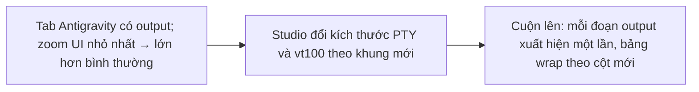
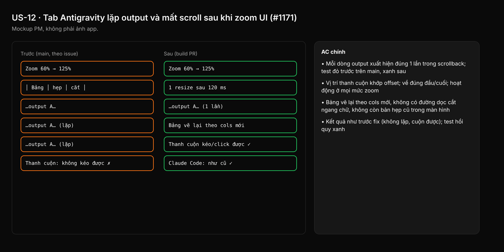

- Issue #1171 · milestone Backlog · trạng thái code 26/10: chưa có PR; chưa rõ nguyên nhân (Bước 0 bắt buộc)

## 1. User Story
Là người dùng Studio chạy Antigravity CLI trong panel Agents, tôi muốn đổi zoom UI (Ctrl+Shift +/-) mà terminal vẫn hiện hội thoại đúng một lần, cuộn và thanh cuộn vẫn dùng được, để đọc lại được output cũ.

## 2. Flow
| Bước | Hành động | Phản hồi |
|---|---|---|
| 1 | Tab Antigravity có output; zoom UI nhỏ nhất → lớn hơn bình thường | Xem AC liên quan |
| 2 | Studio đổi kích thước PTY và vt100 theo khung mới | Xem AC liên quan |
| 3 | Cuộn lên: mỗi đoạn output xuất hiện một lần, bảng wrap theo cột mới | Xem AC liên quan |

## 3. Dữ liệu và quy tắc
- Hiện trạng (main): kích thước lưới tính lại mỗi frame từ khung panel; `TerminalTab::resize` (`terminal.rs:951`) gọi `master.resize` + `parser.set_size` ngay mỗi khi rows/cols đổi (gọi ở `terminal.rs:~5699`). Một lần zoom qua nhiều mức sinh nhiều SIGWINCH liên tiếp.
- Giả thuyết chính (chưa chứng minh): Antigravity vẽ lại toàn màn hình mỗi SIGWINCH và đẩy bản cũ vào scrollback; vt100 `set_size` không reflow nên mỗi kích thước để lại một bản lặp, có cột hẹp. Giả thuyết phụ: thanh cuộn chỉ được vẽ (`terminal.rs:~6066`, `frac = offset/500` trong khi scrollback 5 000 dòng), không nhận kéo/click.
- Bước 0 (trước khi code): ghi byte PTY của Antigravity 1.4.7 khi đổi cols 120→60→160 (script `script -q` hoặc tap trong test), đếm số lần in lại và xem có `ESC[2J`/`ESC[3J` không. Ghi kết quả vào PR. Nếu giả thuyết sai: dừng, cập nhật story này trước khi sửa.
- R1. Resize PTY chỉ khi kích thước đã ổn định (debounce, ví dụ 120 ms không đổi) và không gửi resize trùng; vt100 đổi cùng lúc với PTY.
- R2. Khi CLI xoá màn hình rồi vẽ lại sau resize, scrollback không giữ bản lặp (xử lý `ESC[3J`, hoặc chỉ giữ một bản của vùng vẽ lại).
- R3. Thanh cuộn phản ánh đúng vị trí trong toàn bộ scrollback và kéo/click được ở mọi mức zoom.
- R4. Không đổi hành vi tab Claude Code (hồi quy).
- Chỉ sửa phía Studio; không đòi Antigravity sửa.

Dependency: Liên quan #932 (text bị cắt khi resize panel), #1063 (offset cuộn không clamp), #1173 (cuộn panel Agents). Epic #585.

## 4. Acceptance Criteria
| ID | Given | When | Then | Source |
|---|---|---|---|---|
| AC-01 | Tab Antigravity (hoặc fake CLI vẽ lại toàn màn hình mỗi SIGWINCH, như Ink) có 200 dòng output | Zoom UI qua 5 mức rồi cuộn lên đầu | Mỗi dòng output xuất hiện đúng 1 lần trong scrollback; test đỏ trước trên main, xanh sau | #1171 AC1 |
| AC-02 | Cùng tab sau khi zoom | Kéo thanh cuộn lên đầu, click giữa track, rồi lăn chuột xuống cuối | Vị trí thanh cuộn khớp offset; về đúng đầu/cuối; hoạt động ở mọi mức zoom | #1171 AC2 |
| AC-03 | Output có bảng box-drawing rộng 100 cột | Zoom làm cols giảm còn 70 rồi tăng lại | Bảng vẽ lại theo cols mới, không có đường dọc cắt ngang chữ, không còn bản hẹp cũ trong màn hình | #1171 AC3 |
| AC-04 | Tab Claude Code cùng session | Lặp lại AC-01..03 | Kết quả như trước fix (không lặp, cuộn được); test hồi quy xanh | #1171 AC4 |
| AC-05 | Zoom liên tục (giữ phím) | Đếm lệnh resize gửi tới PTY | Tối đa 1 resize sau khi kích thước ổn định; không resize trùng | R1 |
| AC-06 | Build PR trên Windows 11 (2K/4K) và macOS | QA chạy các bước tái hiện của issue với Antigravity 1.4.7 | Không lặp, thanh cuộn chạy; video hoặc ảnh trước/sau trong PR | #1171 repro |

Test steps: [tests/cases/US-12.md](../tests/cases/US-12.md). Mỗi fix: test đỏ trước trên main `ef26bcc`, xanh sau.

## 5. Edge cases
- Zoom khi CLI đang stream output: không mất dòng, không lặp.
- Zoom khi đang ở giữa scrollback: giữ vị trí đọc gần nhất có thể, không nhảy về cuối.
- CLI ở alternate screen (`?1049h`) với mouse reporting: wheel vẫn gửi SGR tới CLI như cũ.
- Kích thước nhỏ nhất (rows 4 / cols 16 do clamp): không panic, không resize lặp.
- Tab mới mở sau khi đã zoom: kích thước đúng ngay từ đầu.
- Scrollback đầy 5 000 dòng: thanh cuộn vẫn đúng tỉ lệ.

## 6. UI
Ảnh tham chiếu (mockup PM, không phải ảnh app): 

Bằng chứng thật bắt buộc trong PR: video hoặc ảnh trước/sau zoom trên Windows 2K/4K, log đếm resize, output test đỏ→xanh.
