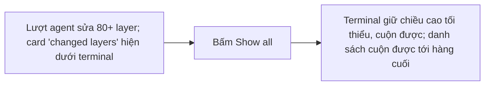
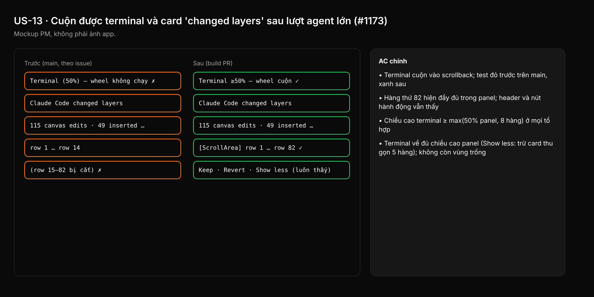

- Issue #1173 · milestone Backlog · trạng thái code 26/10: chưa có PR

## 1. User Story
Là người dùng Studio sau một lượt agent sửa nhiều layer, tôi muốn vẫn cuộn đọc được terminal và cuộn hết danh sách layer đã đổi khi bấm Show all, để kiểm lại toàn bộ thay đổi.

## 2. Flow
| Bước | Hành động | Phản hồi |
|---|---|---|
| 1 | Lượt agent sửa 80+ layer; card 'changed layers' hiện dưới terminal | Xem AC liên quan |
| 2 | Bấm Show all | Xem AC liên quan |
| 3 | Terminal giữ chiều cao tối thiểu, cuộn được; danh sách cuộn được tới hàng cuối | Xem AC liên quan |

## 3. Dữ liệu và quy tắc
- Hiện trạng (main): `panels/left.rs:26,38` dành `reserve = (card_h + 2·INSET_FRAME).min(inner.height()·0.5)` cho card; `agent_turn_card.rs:87-90` tính `card_h` từ **mọi** hàng khi expanded; `show` (`agent_turn_card.rs:112+`) vẽ hết hàng và `allocate_rect` theo `card_h` đầy đủ, không có `ScrollArea` → hàng tràn ra ngoài panel và bị cắt.
- Wheel ở vùng terminal chết: chưa rõ nguyên nhân. Bước 0: log `vp_resp.hovered()` và `smooth_scroll_delta` khi card mở rộng; nghi vấn là vùng hover/allocate của card (cao hơn khung) hoặc lớp khác nuốt wheel. Ghi kết quả vào PR trước khi sửa.
- R1. Card chiếm tối đa 50% chiều cao panel (giữ quy tắc hiện tại); phần hàng nằm trong `ScrollArea` dọc riêng; header, tóm tắt và nút hành động (Keep/Revert/Show less) luôn thấy.
- R2. Terminal luôn còn ít nhất `max(50% panel, 8 hàng)`; wheel trên terminal chỉ cuộn terminal, wheel trên card chỉ cuộn card.
- R3. Thu gọn card (Show less) hoặc Keep/dismiss: terminal lấy lại toàn bộ chiều cao ngay frame sau.
- R4. Không đổi số liệu tóm tắt, thứ tự hàng, hành vi click hàng (chọn layer).

Dependency: Liên quan #1171 (cuộn terminal sau zoom), #888 (panel Agents cắt chữ). Epic #585.

## 4. Acceptance Criteria
| ID | Given | When | Then | Source |
|---|---|---|---|---|
| AC-01 | Panel Agents cao 900 px, tab Claude Code có 300 dòng output, card expanded 82 hàng | Lăn chuột trên vùng terminal | Terminal cuộn vào scrollback; test đỏ trước trên main, xanh sau | #1173 AC1 |
| AC-02 | Cùng trạng thái | Lăn chuột trên danh sách card tới cuối | Hàng thứ 82 hiện đầy đủ trong panel; header và nút hành động vẫn thấy | #1173 AC2 |
| AC-03 | Panel cao 400/900/2000 px, card 5/82/300 hàng | Đo khung terminal | Chiều cao terminal ≥ max(50% panel, 8 hàng) ở mọi tổ hợp | #1173 AC3 |
| AC-04 | Card expanded | Bấm Show less, hoặc Keep | Terminal về đủ chiều cao panel (Show less: trừ card thu gọn 5 hàng); không còn vùng trống | #1173 AC4 |
| AC-05 | Card 3 hàng (không cần cuộn) | Mở lượt agent nhỏ | Không có thanh cuộn; bố cục y như trước fix | R4 |
| AC-06 | Build PR Windows 2K/4K và macOS | QA chạy repro của issue (lượt sửa ~150 layer) | Cả terminal và card cuộn được; ảnh/video trong PR | #1173 repro |

Test steps: [tests/cases/US-13.md](../tests/cases/US-13.md). Mỗi fix: test đỏ trước trên main `ef26bcc`, xanh sau.

## 5. Edge cases
- Card ở trạng thái Reverted (một hàng): không cuộn, không đổi.
- Lượt agent mới đến khi đang cuộn card: card reset về đầu, không panic.
- Resize panel/zoom UI khi card expanded: vẫn giữ R1–R2.
- Wheel ngang hoặc trackpad: chỉ ảnh hưởng vùng dưới con trỏ.
- Click một hàng sau khi cuộn: chọn đúng layer của hàng đó (không lệch offset).
- Screen reader: các hàng ngoài khung vẫn có trong cây a11y hoặc được thông báo số hàng.

## 6. UI
Ảnh tham chiếu (mockup PM, không phải ảnh app): 

Bằng chứng thật bắt buộc trong PR: ảnh/video panel Agents với card 82+ hàng trên Windows 2K/4K, output test layout đỏ→xanh.
