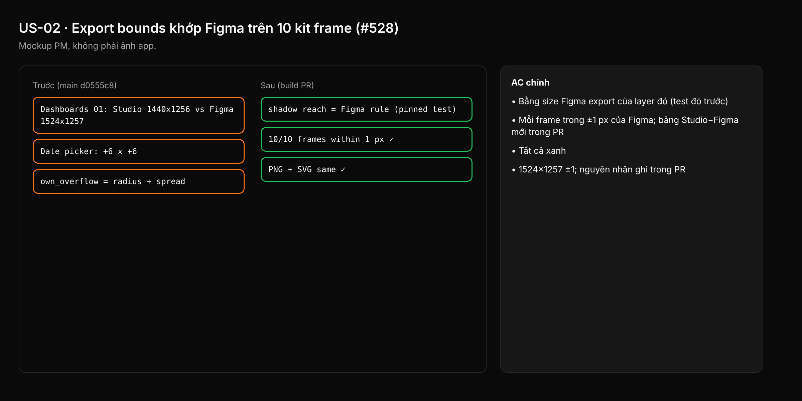
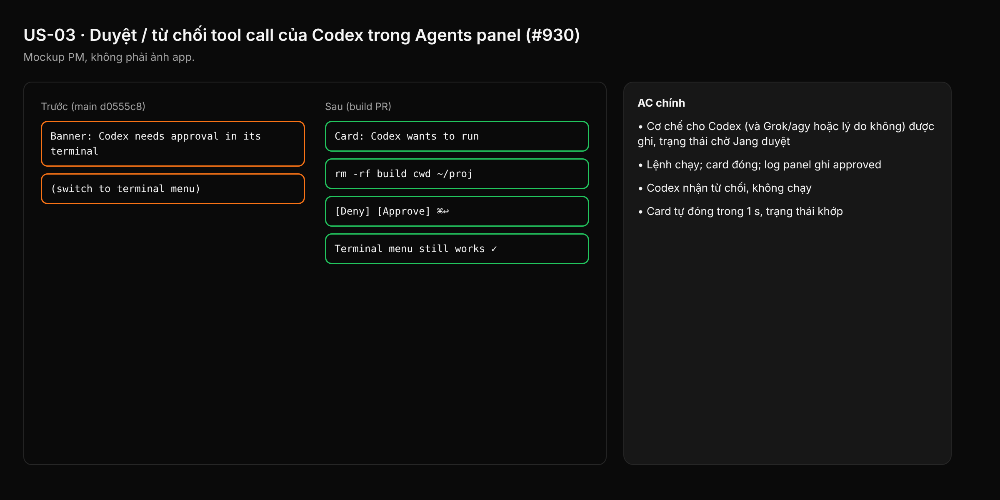
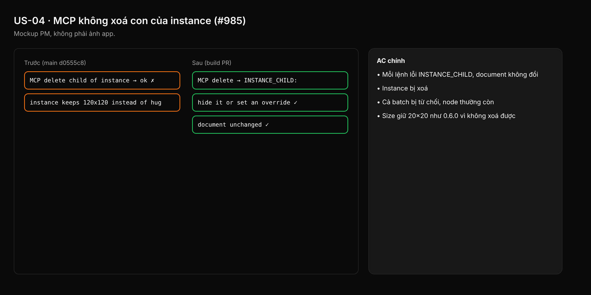
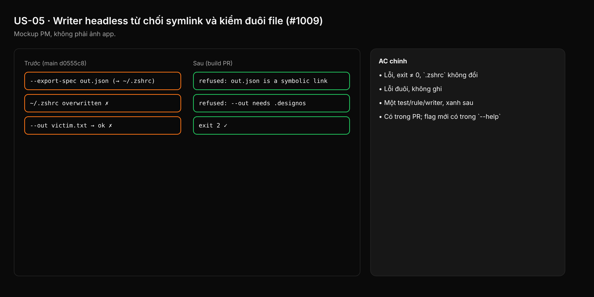
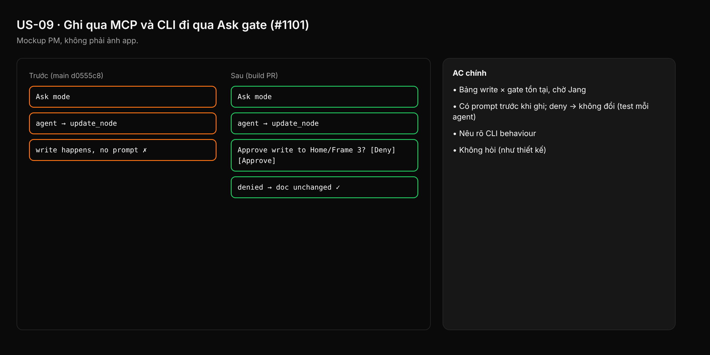
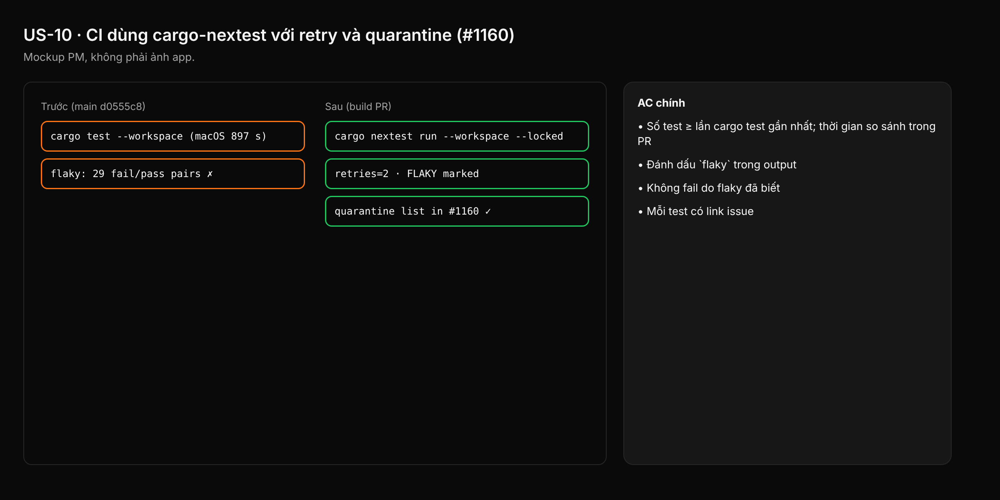
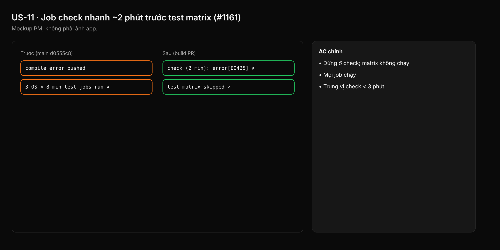
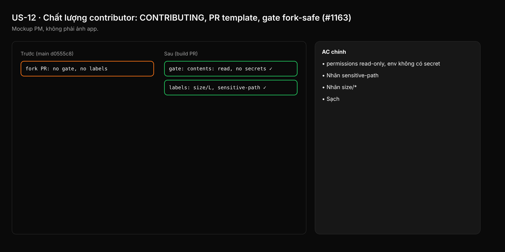
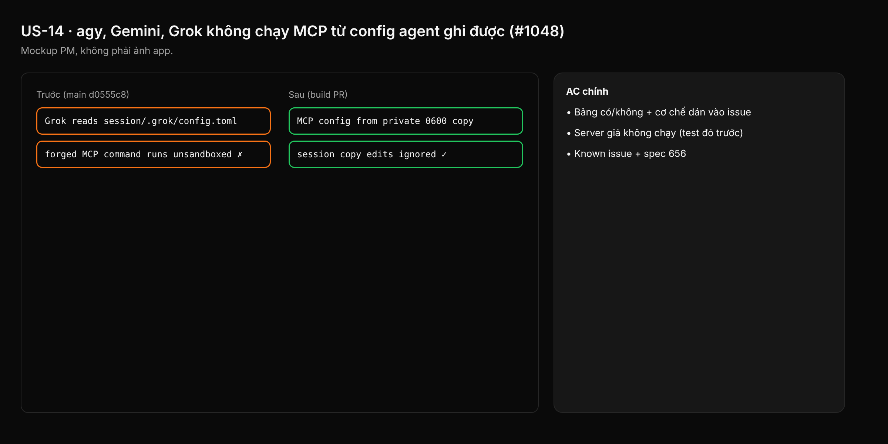

| File | Story | REQ | Patch | Ảnh |
|---|---|---|---|---|
| US-01.md | Shadow trên device mockup khớp Figma (#520) | REQ-01 | v0.7.0 |  |
| US-02.md | Export bounds khớp Figma trên 10 kit frame (#528) | REQ-02 | v0.7.0 |  |
| US-03.md | Duyệt / từ chối tool call của Codex trong Agents panel (#930) | REQ-03 | v0.7.0 |  |
| US-04.md | MCP không xoá con của instance (#985) | REQ-04 | v0.7.1 |  |
| US-05.md | Writer headless từ chối symlink và kiểm đuôi file (#1009) | REQ-05 | v0.7.1 |  |
| US-06.md | Agent không gỡ được tool restriction của người dùng (#1049) | REQ-06 | v0.7.1 |  |
| US-07.md | Status hook không ghi theo symlink trong session (#1050) | REQ-07 | v0.7.1 |  |
| US-08.md | Document chưa lưu không cấp cả ổ đĩa cho designos-mcp (#1074) | REQ-08 | v0.7.2 |  |
| US-09.md | Ghi qua MCP và CLI đi qua Ask gate (#1101) | REQ-09 | v0.7.2 |  |
| US-10.md | CI dùng cargo-nextest với retry và quarantine (#1160) | REQ-10 | v0.7.2 |  |
| US-11.md | Job check nhanh ~2 phút trước test matrix (#1161) | REQ-11 | v0.7.2 |  |
| US-12.md | Chất lượng contributor: CONTRIBUTING, PR template, gate fork-safe (#1163) | REQ-12 | v0.7.2 |  |
| US-13.md | Gemini Ask mode không đọc tools.allowed từ session (#1047) | REQ-13 | v0.7.3 |  |
| US-14.md | agy, Gemini, Grok không chạy MCP từ config agent ghi được (#1048) | REQ-14 | v0.7.3 |  |
