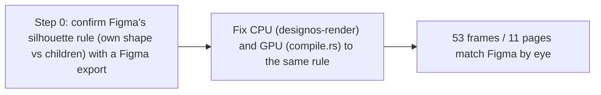

- Issue #520 · milestone v0.7.0 · code status 25/10: no fix PR yet; spec facts in PR #720

## 1. User Story
As a designer opening the Untitled UI kit, I want shadows and layer effects on mobile/device mockups to look like Figma, so I can trust the render in review.

## 2. Flow
| Step | Action | Response |
|---|---|---|
| 1 | Step 0: confirm Figma's silhouette rule (own shape vs children) with a Figma export | See the related AC |
| 2 | Fix CPU (designos-render) and GPU (compile.rs) to the same rule | See the related AC |
| 3 | 53 frames / 11 pages match Figma by eye | See the related AC |

## 3. Data and rules
- FACT (code 0.3.0): a node with a visible fill/stroke → the shadow silhouette is its own shape, children ignored (`lib.rs:507-587`, `compile.rs:998-1050`). Frames without a fill are not yet checked.
- R1. No guessing: the PR attaches 3 minimal Figma export pairs (frame with fill; fill-less frame with children; fill-less clipped frame) as fixtures.
- R2. CPU and GPU share one silhouette decision function.
- R3. A bucket may mix causes: frames still off after the fix get a new issue; the PR isn't widened.

Dependency: kit .fig + Figma export (Ease Design agent) on the dev machine. Related to #528 (bounds).

## 4. Acceptance Criteria
| ID | Given | When | Then | Source |
|---|---|---|---|---|
| AC-01 | 3 Figma fixtures (fill, fill-less with children, fill-less clipped) | Render CPU and GPU | Image diff vs the Figma export < 0.02 per fixture; rule recorded in the PR | #520 AC1 |
| AC-02 | Kit, the 8 frames in the issue table (e.g. `6277:316411`) | Render CPU and GPU, side by side with Figma | Shadows match by eye; audit score < 0.15 (from 0.25–0.52) | #520 AC2 |
| AC-03 | The other 45 frames in the audit CSV | Rerun the audit | Fewer major frames; frames still off have their own issue | R3 |
| AC-04 | Existing bounds/shadow tests | cargo test | No test breaks | regression |

Test steps: [tests/cases/US-01.md](../tests/cases/US-01.md). For every fix: a failing test first on main `d0555c8`, green after.

## 5. Edge cases
- Shadow with negative spread.
- Frame clipping content + shadow: the shadow follows the frame shape.
- A child with its own shadow inside a fill-less frame: not doubled.
- Hidden layers (visible=false) don't contribute to the silhouette.
- Frame opacity < 1 applies to the shadow as in Figma.

## 6. UI
Reference image (PM mockup, not an app screenshot): 

Real evidence required in the PR: Figma | Studio | diff images for the 8 frames.
