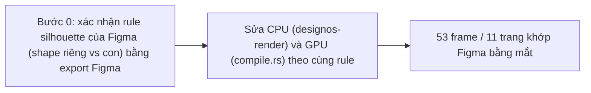
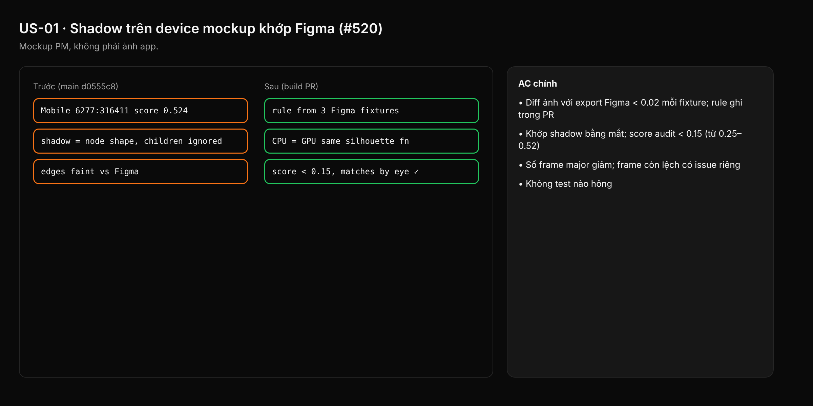

- Issue #520 · milestone v0.7.0 · trạng thái code 25/10: chưa có PR fix; spec facts PR #720

## 1. User Story
Là designer mở kit Untitled UI, tôi muốn shadow và layer effect trên mobile/device mockup giống Figma, để render tin được khi review.

## 2. Flow
| Bước | Hành động | Phản hồi |
|---|---|---|
| 1 | Bước 0: xác nhận rule silhouette của Figma (shape riêng vs con) bằng export Figma | Xem AC liên quan |
| 2 | Sửa CPU (designos-render) và GPU (compile.rs) theo cùng rule | Xem AC liên quan |
| 3 | 53 frame / 11 trang khớp Figma bằng mắt | Xem AC liên quan |

## 3. Dữ liệu và quy tắc
- FACT (code 0.3.0): node có fill/stroke hiện → silhouette shadow là shape riêng, bỏ qua con (`lib.rs:507-587`, `compile.rs:998-1050`). Chưa kiểm frame không fill.
- R1. Không đoán: PR dán 3 cặp export Figma tối giản (frame có fill; frame không fill có con; frame không fill clip) làm fixture.
- R2. CPU và GPU dùng chung một hàm quyết định silhouette.
- R3. Bucket có thể lẫn nguyên nhân: frame còn lệch sau fix được tách issue mới, không mở rộng PR.

Dependency: Kit .fig + Figma export (Ease Design agent) trên máy dev. Liên quan #528 (bounds).

## 4. Acceptance Criteria
| ID | Given | When | Then | Source |
|---|---|---|---|---|
| AC-01 | 3 fixture Figma (fill, không fill có con, không fill clip) | Render CPU và GPU | Diff ảnh với export Figma < 0.02 mỗi fixture; rule ghi trong PR | #520 AC1 |
| AC-02 | Kit, 8 frame trong bảng issue (vd `6277:316411`) | Render CPU và GPU, đặt cạnh Figma | Khớp shadow bằng mắt; score audit < 0.15 (từ 0.25–0.52) | #520 AC2 |
| AC-03 | 45 frame còn lại trong CSV audit | Chạy lại audit | Số frame major giảm; frame còn lệch có issue riêng | R3 |
| AC-04 | Test bounds/shadow hiện có | cargo test | Không test nào hỏng | regression |

Test steps: [tests/cases/US-01.md](../tests/cases/US-01.md). Mỗi fix: test đỏ trước trên main `d0555c8`, xanh sau.

## 5. Edge cases
- Shadow với spread âm.
- Frame clip content + shadow: shadow theo shape frame.
- Con có shadow riêng trong frame không fill: không nhân đôi.
- Layer ẩn (visible=false) không đóng góp silhouette.
- Opacity frame < 1 áp lên shadow như Figma.

## 6. UI
Ảnh tham chiếu (mockup PM, không phải ảnh app): 

Bằng chứng thật bắt buộc trong PR: ảnh Figma | Studio | diff cho 8 frame.
