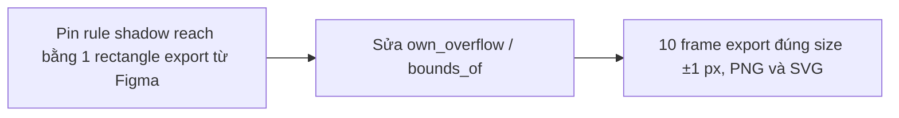

- Issue #528 · milestone v0.7.0 · trạng thái code 25/10: PR #771 open (chưa merge)

## 1. User Story
Là designer export PNG/SVG, tôi muốn kích thước file bằng Figma (±1 px), để asset thay thế được mà không lệch layout.

## 2. Flow
| Bước | Hành động | Phản hồi |
|---|---|---|
| 1 | Pin rule shadow reach bằng 1 rectangle export từ Figma | Xem AC liên quan |
| 2 | Sửa own_overflow / bounds_of | Xem AC liên quan |
| 3 | 10 frame export đúng size ±1 px, PNG và SVG | Xem AC liên quan |

## 3. Dữ liệu và quy tắc
- Ruling owner 2026-10-18: export khớp render bounds của Figma.
- Lớn hơn 2–8 px ở 6 frame: nghi `own_overflow` cộng `radius + spread` mỗi cạnh (`bounds.rs:53-58`).
- Nhỏ hơn ở 3 frame (Dashboards 01 Desktop −84 px, Context menu −9, badge −2): thứ Figma tính overflow mà `bounds_of` (`bounds.rs:81`) không.
- R1. Test đơn vị: rect 100x40, drop shadow (0,4) blur 8 → size bằng Figma export (giá trị thật dán vào test).
- R2. Không dùng `render_node` (crop) để đo; dùng `render_export`.

Dependency: PR #771. Kit + Figma export.

## 4. Acceptance Criteria
| ID | Given | When | Then | Source |
|---|---|---|---|---|
| AC-01 | Rect 100x40, shadow (0,4) blur 8 | render_bounds | Bằng size Figma export của layer đó (test đỏ trước) | #528 AC2 |
| AC-02 | 10 frame trong bảng issue | Export PNG 1x và SVG | Mỗi frame trong ±1 px của Figma; bảng Studio−Figma mới trong PR | #528 AC1 |
| AC-03 | Test bounds.rs hiện có | cargo test -p designos-export | Tất cả xanh | #528 AC3 |
| AC-04 | Dashboards 01 Desktop (−84 px) | Export | 1524x1257 ±1; nguyên nhân ghi trong PR | #528 |

Test steps: [tests/cases/US-02.md](../tests/cases/US-02.md). Mỗi fix: test đỏ trước trên main `d0555c8`, xanh sau.

## 5. Edge cases
- Scale 2x/3x: size = 1x × scale, làm tròn như Figma.
- Stroke outside + shadow cùng lúc.
- Con unclipped vượt khung âm (x<0).
- Blur layer (không phải shadow).
- Frame không có effect: size = node box.

## 6. UI
Ảnh tham chiếu (mockup PM, không phải ảnh app): 

Bằng chứng thật bắt buộc trong PR: output test/terminal trên build PR.
