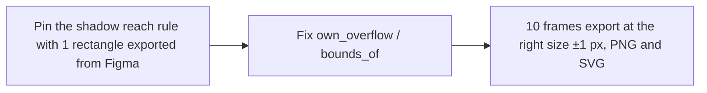

- Issue #528 · milestone v0.7.0 · code status 25/10: PR #771 open (not merged)

## 1. User Story
As a designer exporting PNG/SVG, I want the file size to equal Figma's (±1 px), so assets can be swapped in without shifting the layout.

## 2. Flow
| Step | Action | Response |
|---|---|---|
| 1 | Pin the shadow reach rule with 1 rectangle exported from Figma | See the related AC |
| 2 | Fix own_overflow / bounds_of | See the related AC |
| 3 | 10 frames export at the right size ±1 px, PNG and SVG | See the related AC |

## 3. Data and rules
- Owner ruling 2026-10-18: export matches Figma's render bounds.
- 2–8 px larger on 6 frames: suspect `own_overflow` adding `radius + spread` per side (`bounds.rs:53-58`).
- Smaller on 3 frames (Dashboards 01 Desktop −84 px, Context menu −9, badge −2): something Figma counts as overflow that `bounds_of` (`bounds.rs:81`) doesn't.
- R1. Unit test: rect 100x40, drop shadow (0,4) blur 8 → size equals the Figma export (real value pasted into the test).
- R2. Don't measure with `render_node` (crop); use `render_export`.

Dependency: PR #771. Kit + Figma export.

## 4. Acceptance Criteria
| ID | Given | When | Then | Source |
|---|---|---|---|---|
| AC-01 | Rect 100x40, shadow (0,4) blur 8 | render_bounds | Equals the Figma export size of that layer (failing test first) | #528 AC2 |
| AC-02 | The 10 frames in the issue table | Export PNG 1x and SVG | Each frame within ±1 px of Figma; a new Studio−Figma table in the PR | #528 AC1 |
| AC-03 | Existing bounds.rs tests | cargo test -p designos-export | All green | #528 AC3 |
| AC-04 | Dashboards 01 Desktop (−84 px) | Export | 1524x1257 ±1; cause recorded in the PR | #528 |

Test steps: [tests/cases/US-02.md](../tests/cases/US-02.md). For every fix: a failing test first on main `d0555c8`, green after.

## 5. Edge cases
- Scale 2x/3x: size = 1x × scale, rounded as Figma does.
- Outside stroke + shadow together.
- Unclipped children overflowing to negative coordinates (x<0).
- Layer blur (not shadow).
- Frame with no effects: size = node box.

## 6. UI
Reference image (PM mockup, not an app screenshot): 

Real evidence required in the PR: test/terminal output on the PR build.
