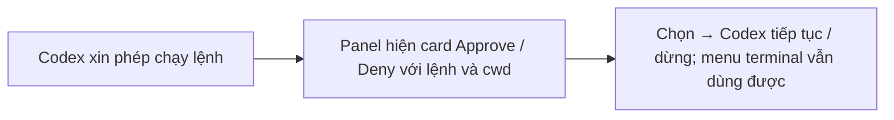

- Issue #930 · milestone v0.7.0 · trạng thái code 25/10: PR #1051 open; spec plans/261024-0000-930-codex-approval-cards

## 1. User Story
Là người dùng Ask mode, tôi muốn duyệt hoặc từ chối tool call của Codex ngay trong Agents panel như Claude, để không phải chuyển sang terminal của nó.

## 2. Flow
| Bước | Hành động | Phản hồi |
|---|---|---|
| 1 | Codex xin phép chạy lệnh | Xem AC liên quan |
| 2 | Panel hiện card Approve / Deny với lệnh và cwd | Xem AC liên quan |
| 3 | Chọn → Codex tiếp tục / dừng; menu terminal vẫn dùng được | Xem AC liên quan |

## 3. Dữ liệu và quy tắc
- R1. Decision record chọn cơ chế: `codex app-server` (ưu tiên, có API) hay bơm phím vào menu; ghi cho Grok, agy nếu làm được.
- R2. Card hiện: agent, lệnh đầy đủ (không cắt phần path), cwd, nút Approve / Deny; phím tắt.
- R3. Trả lời ở terminal thì card đóng; trả lời ở card thì terminal không treo.
- R4. Agent không tự trả lời được approval của chính nó (xem #1023).

Dependency: PR #1051, spec 656 §3.5. Codex 0.162+.

## 4. Acceptance Criteria
| ID | Given | When | Then | Source |
|---|---|---|---|---|
| AC-01 | Decision record | Jang review | Cơ chế cho Codex (và Grok/agy hoặc lý do không) được ghi, trạng thái chờ Jang duyệt | #930 AC1 |
| AC-02 | Codex Ask mode xin chạy `rm -rf build` | Bấm Approve trên card | Lệnh chạy; card đóng; log panel ghi approved | #930 AC2 |
| AC-03 | Như trên | Bấm Deny | Codex nhận từ chối, không chạy | #930 AC2 |
| AC-04 | Card đang mở | Trả lời trong menu terminal | Card tự đóng trong 1 s, trạng thái khớp | R3 |
| AC-05 | Agent ghi file vào thư mục approval | Giả mạo câu trả lời | Bị bỏ qua, card vẫn chờ | R4 |

Test steps: [tests/cases/US-03.md](../tests/cases/US-03.md). Mỗi fix: test đỏ trước trên main `d0555c8`, xanh sau.

## 5. Edge cases
- Nhiều approval xếp hàng: card theo thứ tự, hiện số đang chờ.
- Tab bị đóng khi card mở: card huỷ.
- Codex phiên bản không hỗ trợ app-server: fallback banner cũ + thông báo phiên bản.
- Lệnh rất dài: cuộn, không cắt.
- Mất kết nối app-server: card báo lỗi, terminal vẫn dùng được.

## 6. UI
Ảnh tham chiếu (mockup PM, không phải ảnh app): 

Bằng chứng thật bắt buộc trong PR: ảnh card trên build PR, macOS.
