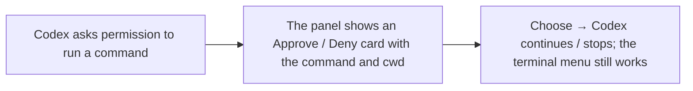

- Issue #930 · milestone v0.7.0 · code status 25/10: PR #1051 open; spec plans/261024-0000-930-codex-approval-cards

## 1. User Story
As an Ask mode user, I want to approve or deny Codex tool calls right in the Agents panel, as with Claude, so I don't have to switch to its terminal.

## 2. Flow
| Step | Action | Response |
|---|---|---|
| 1 | Codex asks permission to run a command | See the related AC |
| 2 | The panel shows an Approve / Deny card with the command and cwd | See the related AC |
| 3 | Choose → Codex continues / stops; the terminal menu still works | See the related AC |

## 3. Data and rules
- R1. A decision record picks the mechanism: `codex app-server` (structured API; no keystroke injection and no PTY scraping, per the #930 non-goals); also record Grok and agy if feasible.
- R2. The card shows: agent, full command (path not cut), cwd, Approve / Deny buttons; keyboard shortcuts.
- R3. Answering in the terminal closes the card; answering on the card doesn't hang the terminal.
- R4. An agent can't answer its own approval (see #1023).

Dependency: PR #1051, spec 656 §3.5. Codex 0.164.x (gate per design/v0.7.0/930-spec.md).

## 4. Acceptance Criteria
| ID | Given | When | Then | Source |
|---|---|---|---|---|
| AC-01 | Decision record | Jang reviews | The mechanism for Codex (and Grok/agy, or the reason not) is recorded, status pending Jang's approval | #930 AC1 |
| AC-02 | Codex in Ask mode asks to run `rm -rf build` | Click Approve on the card | The command runs; the card closes; the panel log records approved | #930 AC2 |
| AC-03 | Same as above | Click Deny | Codex gets a refusal and doesn't run it | #930 AC2 |
| AC-04 | A card is open | Answer in the terminal menu | The card closes by itself within 1 s, state matches | R3 |
| AC-05 | An agent writes a file into the approval folder | Forges an answer | Ignored, the card keeps waiting | R4 |

Test steps: [tests/cases/US-03.md](../tests/cases/US-03.md). For every fix: a failing test first on main `d0555c8`, green after.

## 5. Edge cases
- Several approvals queued: cards in order, showing the number waiting.
- Tab closed while a card is open: the card is cancelled.
- A Codex version without app-server support: fall back to the old banner + a version notice.
- Very long command: scroll, don't cut.
- Lost app-server connection: the card reports an error, the terminal still works.

## 6. UI
Reference image (PM mockup, not an app screenshot): 

Real evidence required in the PR: card screenshot on the PR build, macOS.
