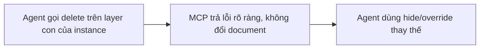

- Issue #985 · milestone v0.7.1 · trạng thái code 25/10: PM chọn PR #1130 (25/10); #1034 không merge

## 1. User Story
Là designer dùng agent, tôi muốn MCP từ chối xoá layer bên trong instance như editor, để agent không làm hỏng instance (mất size hug).

## 2. Flow
| Bước | Hành động | Phản hồi |
|---|---|---|
| 1 | Agent gọi delete trên layer con của instance | Xem AC liên quan |
| 2 | MCP trả lỗi rõ ràng, không đổi document | Xem AC liên quan |
| 3 | Agent dùng hide/override thay thế | Xem AC liên quan |

## 3. Dữ liệu và quy tắc
- R1. Xoá node có tổ tiên là instance (không phải main): lỗi `INSTANCE_CHILD` + gợi ý "hide it or set an override".
- R2. Xoá chính instance vẫn được.
- R3. Cùng rule với editor (một hàm chung).
- R4. Batch delete có một id bị cấm: cả batch bị từ chối (atomic).

Dependency: PR #1130 (PM chọn 25/10: đủ R1–R4, test batch atomic + nested instance). #1034 không merge (chỉ engine.rs, thiếu R4, mã lỗi khác). Việc còn lại trên #1130: retarget từ release/v0.6.2 sang main, đổi mã lỗi INVALID_ARGUMENTS → `INSTANCE_CHILD` (R1), CI Ubuntu chạy lại (lần trước runner bị tắt, không phải test lỗi). Đóng #1034: Jang.

## 4. Acceptance Criteria
| ID | Given | When | Then | Source |
|---|---|---|---|---|
| AC-01 | Instance có 3 con | MCP delete từng con | Mỗi lệnh lỗi INSTANCE_CHILD, document không đổi | #985 |
| AC-02 | Như trên | MCP delete chính instance | Instance bị xoá | R2 |
| AC-03 | Batch [node thường, con instance] | delete_nodes | Cả batch bị từ chối, node thường còn | R4 |
| AC-04 | Instance auto layout hug | Agent thử xoá hết con | Size giữ 20x20 như 0.6.0 vì không xoá được | #985 |

Test steps: [tests/cases/US-04.md](../tests/cases/US-04.md). Mỗi fix: test đỏ trước trên main `d0555c8`, xanh sau.

## 5. Edge cases
- Con trong instance lồng instance.
- Node trong main component: xoá được.
- Instance đã detach: xoá con được.
- Undo không cần vì không đổi gì.

## 6. UI
Ảnh tham chiếu (mockup PM, không phải ảnh app): 

Bằng chứng thật bắt buộc trong PR: output test/terminal trên build PR.
