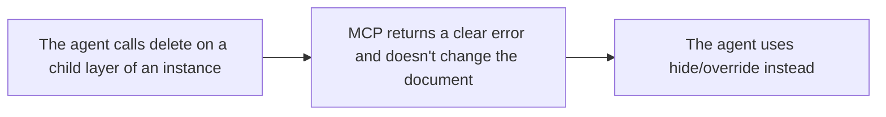

- Issue #985 · milestone v0.7.1 · code status 25/10: PM chose PR #1130 (25/10); #1034 will not merge

## 1. User Story
As a designer using an agent, I want MCP to refuse deleting layers inside an instance, as the editor does, so the agent can't break the instance (losing hug size).

## 2. Flow
| Step | Action | Response |
|---|---|---|
| 1 | The agent calls delete on a child layer of an instance | See the related AC |
| 2 | MCP returns a clear error and doesn't change the document | See the related AC |
| 3 | The agent uses hide/override instead | See the related AC |

## 3. Data and rules
- R1. Deleting a node whose ancestor is an instance (not the main): error `INSTANCE_CHILD` + hint "hide it or set an override".
- R2. Deleting the instance itself still works.
- R3. Same rule as the editor (one shared function).
- R4. A batch delete containing one forbidden id: the whole batch is refused (atomic).

Dependency: PR #1130 (PM chose 25/10: covers R1–R4, batch atomic + nested instance tests). #1034 will not merge (engine.rs only, missing R4, different error code). Remaining work on #1130: retarget from release/v0.6.2 to main, change the error code INVALID_ARGUMENTS → `INSTANCE_CHILD` (R1), rerun Ubuntu CI (the last runner was shut down, not a test failure). Closing #1034: Jang.

## 4. Acceptance Criteria
| ID | Given | When | Then | Source |
|---|---|---|---|---|
| AC-01 | An instance with 3 children | MCP deletes each child | Each call fails with INSTANCE_CHILD, the document is unchanged | #985 |
| AC-02 | Same as above | MCP deletes the instance itself | The instance is deleted | R2 |
| AC-03 | Batch [normal node, instance child] | delete_nodes | The whole batch is refused, the normal node remains | R4 |
| AC-04 | A hug auto layout instance | The agent tries to delete all children | Size stays 20x20 as in 0.6.0 because nothing can be deleted | #985 |

Test steps: [tests/cases/US-04.md](../tests/cases/US-04.md). For every fix: a failing test first on main `d0555c8`, green after.

## 5. Edge cases
- A child inside an instance nested in an instance.
- A node in the main component: can be deleted.
- A detached instance: children can be deleted.
- No undo needed since nothing changes.

## 6. UI
Reference image (PM mockup, not an app screenshot): 

Real evidence required in the PR: test/terminal output on the PR build.
