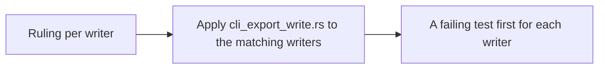

- Issue #1009 · milestone v0.7.1 · code status 25/10: PR #1081 open

## 1. User Story
As a user running agents, I want every headless writer (--export-spec, --export-variables, --screenshot, --out) to not write through a link or with the wrong extension, so an agent can't overwrite other files via DESIGNOS_BIN.

## 2. Flow
| Step | Action | Response |
|---|---|---|
| 1 | Ruling per writer | See the related AC |
| 2 | Apply cli_export_write.rs to the matching writers | See the related AC |
| 3 | A failing test first for each writer | See the related AC |

## 3. Data and rules
| Writer | Refuse symlink | Required extension | Refuse existing file |
|---|---|---|---|
| --export-spec | yes | .json | no (explicit overwrite) |
| --export-variables | yes | .json | no |
| --screenshot (+frames) | yes | .png | no |
| --out / save in-place | yes | .designos | no (in-place) |
- The table above is PM's proposal; the PR records the final ruling. New flags must appear in `--help`.

Dependency: PR #1081; follows #1000/PR #1005.

## 4. Acceptance Criteria
| ID | Given | When | Then | Source |
|---|---|---|---|---|
| AC-01 | `out.json` is a symlink to `~/.zshrc` | `--export-spec out.json` | Error, exit ≠ 0, `.zshrc` unchanged | #1009 |
| AC-02 | `--import-capture X --out victim.txt` | Run | Extension error, nothing written | #1009 |
| AC-03 | Each writer in the table | Failing test first | One test per rule per writer, green after | #1009 AC2 |
| AC-04 | Ruling table | Review | In the PR; new flags appear in `--help` | #1009 AC1,3 |

Test steps: [tests/cases/US-05.md](../tests/cases/US-05.md). For every fix: a failing test first on main `d0555c8`, green after.

## 5. Edge cases
- Parent folder is a symlink (macOS /tmp → /private/tmp): allowed.
- Link swapped between check and write: use O_NOFOLLOW/temp+rename.
- Uppercase extension .PNG: accepted.
- Frame sequence: each file is checked separately.

## 6. UI
Reference image (PM mockup, not an app screenshot): 

Real evidence required in the PR: test/terminal output on the PR build.
