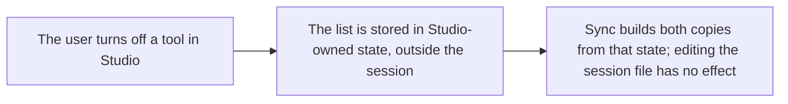

- Issue #1049 · milestone v0.7.1 · code status 25/10: PR #1075 open

## 1. User Story
As a user who turns off a designos tool, I want the agent to be unable to turn it back on through the session's mcp-config.json.

## 2. Flow
| Step | Action | Response |
|---|---|---|
| 1 | The user turns off a tool in Studio | See the related AC |
| 2 | The list is stored in Studio-owned state, outside the session | See the related AC |
| 3 | Sync builds both copies from that state; editing the session file has no effect | See the related AC |

## 3. Data and rules
- R1. `enabled_tools`/`known_tools` are stored outside the session folder (Studio data dir, 0600).
- R2. Sync doesn't read these two fields from `<session>/mcp-config.json`.
- R3. Migration: on first run, take the user's current values once, then stop reading them.

Dependency: PR #1075.

## 4. Acceptance Criteria
| ID | Given | When | Then | Source |
|---|---|---|---|---|
| AC-01 | The user turns off `designos_save_file` | The agent edits the session mcp-config.json to turn it on, Studio syncs | The tool stays off in both copies (failing test first) | #1049 |
| AC-02 | Old settings in the session | First upgrade | The user's list is unchanged after migration | R3 |
| AC-03 | The user turns it back on in the UI | Sync | The tool is on | R1 |

Test steps: [tests/cases/US-06.md](../tests/cases/US-06.md). For every fix: a failing test first on main `d0555c8`, green after.

## 5. Edge cases
- Corrupt state file: use the default settings and show a warning; don't re-read from the session.
- Several windows: same state.
- A new, unknown tool: follows Studio's default.

## 6. UI
Reference image (PM mockup, not an app screenshot): 

Real evidence required in the PR: test/terminal output on the PR build.
