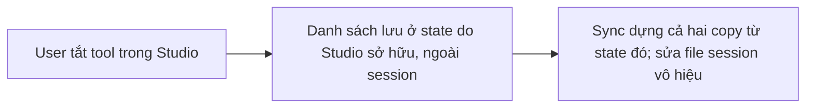
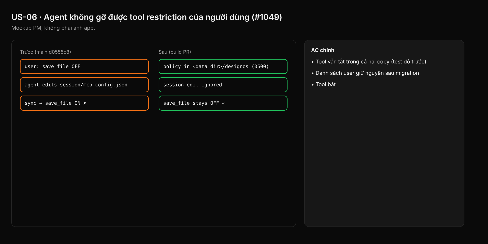

- Issue #1049 · milestone v0.7.1 · trạng thái code 25/10: PR #1075 open

## 1. User Story
Là người dùng tắt một tool designos, tôi muốn agent không bật lại được qua mcp-config.json của session.

## 2. Flow
| Bước | Hành động | Phản hồi |
|---|---|---|
| 1 | User tắt tool trong Studio | Xem AC liên quan |
| 2 | Danh sách lưu ở state do Studio sở hữu, ngoài session | Xem AC liên quan |
| 3 | Sync dựng cả hai copy từ state đó; sửa file session vô hiệu | Xem AC liên quan |

## 3. Dữ liệu và quy tắc
- R1. `enabled_tools`/`known_tools` lưu ngoài session folder (data dir Studio, 0600).
- R2. Sync không đọc hai field này từ `<session>/mcp-config.json`.
- R3. Migration: lần đầu, lấy giá trị hiện có của user một lần rồi thôi đọc.

Dependency: PR #1075.

## 4. Acceptance Criteria
| ID | Given | When | Then | Source |
|---|---|---|---|---|
| AC-01 | User tắt `designos_save_file` | Agent sửa session mcp-config.json bật lại, Studio sync | Tool vẫn tắt trong cả hai copy (test đỏ trước) | #1049 |
| AC-02 | Cài đặt cũ trong session | Nâng cấp lần đầu | Danh sách user giữ nguyên sau migration | R3 |
| AC-03 | User bật lại trong UI | Sync | Tool bật | R1 |

Test steps: [tests/cases/US-06.md](../tests/cases/US-06.md). Mỗi fix: test đỏ trước trên main `d0555c8`, xanh sau.

## 5. Edge cases
- File state hỏng: dùng mặc định cài đặt và hiện cảnh báo; không đọc lại từ session.
- Nhiều cửa sổ: cùng state.
- Tool mới chưa biết: theo mặc định Studio.

## 6. UI
Ảnh tham chiếu (mockup PM, không phải ảnh app): 

Bằng chứng thật bắt buộc trong PR: output test/terminal trên build PR.
