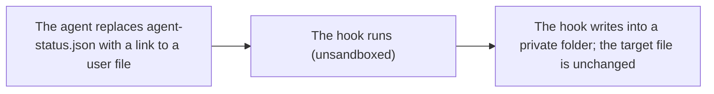
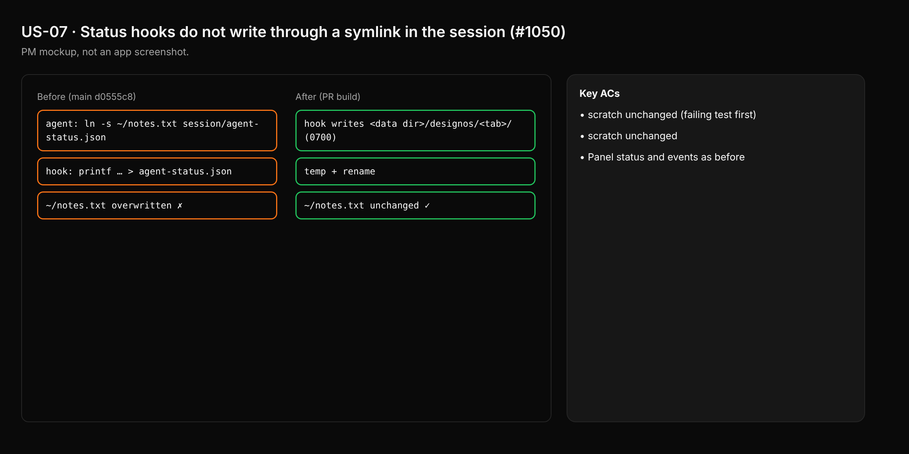

- Issue #1050 · milestone v0.7.1 · code status 25/10: PM chose PR #1085 (25/10, via #1072); #1070 will not merge

## 1. User Story
As a user, I want status hooks to never write through a link an agent planted, so my files aren't overwritten.

## 2. Flow
| Step | Action | Response |
|---|---|---|
| 1 | The agent replaces agent-status.json with a link to a user file | See the related AC |
| 2 | The hook runs (unsandboxed) | See the related AC |
| 3 | The hook writes into a private folder; the target file is unchanged | See the related AC |

## 3. Data and rules
- R1. The hook writes into a private 0700 folder outside the agent's grant, temp+rename.
- R2. Don't use `[ -L ]` (race).
- R3. A single PR: PM chose #1085 (25/10). #1070 will not merge.

Dependency: PR #1085 (design B: all hook output goes to `<data dir>/designos/ap/<sid>/hook-out` 0700; covers every CLI; Ubuntu/macOS/clippy/fmt green), issue #1072. #1050 closes with #1085 (add `Closes #1050` to the body). PR #1070 will not merge: it still writes in the session folder (the issue's lower-ranked direction) and only covers status/events.

## 4. Acceptance Criteria
| ID | Given | When | Then | Source |
|---|---|---|---|---|
| AC-01 | Link `session/agent-status.json → scratch` | Run the hook command | scratch unchanged (failing test first) | #1050 |
| AC-02 | Link `agent-events.jsonl → scratch` | The hook appends | scratch unchanged | #1050 |
| AC-03 | No link | A normal turn | Panel status and events as before | regression |

Test steps: [tests/cases/US-07.md](../tests/cases/US-07.md). For every fix: a failing test first on main `d0555c8`, green after.

## 5. Edge cases
- Hardlink: don't write into the shared inode (rename creates a new inode).
- Private folder deleted: the hook recreates it 0700.
- Several tabs: a separate file per tab.

## 6. UI
Reference image (PM mockup, not an app screenshot): 

Real evidence required in the PR: test/terminal output on the PR build.
