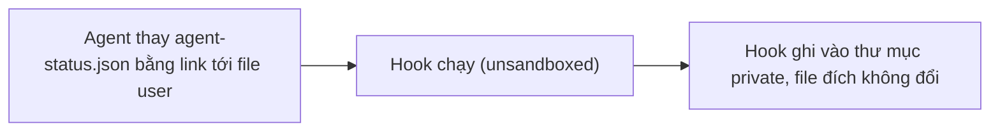

- Issue #1050 · milestone v0.7.1 · trạng thái code 25/10: PR #1070 open; trùng phạm vi với #1072/PR #1085 (hardening US-04)

## 1. User Story
Là người dùng, tôi muốn hook status không bao giờ ghi theo link agent cài, để file của tôi không bị ghi đè.

## 2. Flow
| Bước | Hành động | Phản hồi |
|---|---|---|
| 1 | Agent thay agent-status.json bằng link tới file user | Xem AC liên quan |
| 2 | Hook chạy (unsandboxed) | Xem AC liên quan |
| 3 | Hook ghi vào thư mục private, file đích không đổi | Xem AC liên quan |

## 3. Dữ liệu và quy tắc
- R1. Hook ghi vào thư mục private 0700 ngoài grant agent, temp+rename.
- R2. Không dùng `[ -L ]` (race).
- R3. Một PR duy nhất: #1070 hoặc #1085 — Jang chọn, đóng PR kia.

Dependency: PR #1070, PR #1085, issue #1072.

## 4. Acceptance Criteria
| ID | Given | When | Then | Source |
|---|---|---|---|---|
| AC-01 | Link `session/agent-status.json → scratch` | Chạy lệnh hook | scratch không đổi (test đỏ trước) | #1050 |
| AC-02 | Link `agent-events.jsonl → scratch` | Hook append | scratch không đổi | #1050 |
| AC-03 | Không có link | Turn bình thường | Panel status và events như cũ | regression |

Test steps: [tests/cases/US-07.md](../tests/cases/US-07.md). Mỗi fix: test đỏ trước trên main `d0555c8`, xanh sau.

## 5. Edge cases
- Hardlink: không ghi vào inode chung (rename tạo inode mới).
- Thư mục private bị xoá: hook tạo lại 0700.
- Nhiều tab: file riêng mỗi tab.

## 6. UI
Ảnh tham chiếu (mockup PM, không phải ảnh app): 

Bằng chứng thật bắt buộc trong PR: output test/terminal trên build PR.
