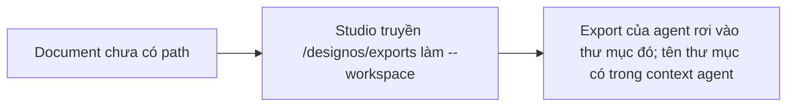

- Issue #1074 · milestone v0.7.2 · trạng thái code 25/10: PR #1150 open

## 1. User Story
Là người dùng mở Studio từ Finder với file Untitled, tôi muốn workspace của designos-mcp là thư mục export riêng, không phải `/`.

## 2. Flow
| Bước | Hành động | Phản hồi |
|---|---|---|
| 1 | Document chưa có path | Xem AC liên quan |
| 2 | Studio truyền `<data dir>/designos/exports` làm --workspace | Xem AC liên quan |
| 3 | Export của agent rơi vào thư mục đó; tên thư mục có trong context agent | Xem AC liên quan |

## 3. Dữ liệu và quy tắc
- R1. Không bao giờ truyền `/` hoặc `$HOME` làm --workspace.
- R2. Doc không path → thư mục export do Studio sở hữu, tạo nếu thiếu.
- R3. Nếu có agent CLI chạy MCP tool không hỏi ở Ask mode (kiểm Codex), nâng thành release blocker và báo Jang.

Dependency: PR #1150.

## 4. Acceptance Criteria
| ID | Given | When | Then | Source |
|---|---|---|---|---|
| AC-01 | Studio cwd `/`, doc Untitled | Mở tab agent | Arg --workspace không phải `/` hay `$HOME` (test đỏ trước) | #1074 |
| AC-02 | Như trên | Agent gọi designos_render_png | File nằm trong thư mục export | #1074 |
| AC-03 | Doc có path | Mở tab | Workspace = thư mục của doc (như cũ) | regression |
| AC-04 | Codex Ask mode | Gọi MCP write tool | Kết quả hỏi/không hỏi ghi vào issue | R3 |

Test steps: [tests/cases/US-08.md](../tests/cases/US-08.md). Mỗi fix: test đỏ trước trên main `d0555c8`, xanh sau.

## 5. Edge cases
- Lưu doc sau khi tab mở: tab mới dùng thư mục doc; tab cũ ghi chú.
- Thư mục export không ghi được: lỗi rõ.
- Doc lưu thẳng trong $HOME: không cấp $HOME, dùng thư mục export và báo cho agent.

## 6. UI
Ảnh tham chiếu (mockup PM, không phải ảnh app): 

Bằng chứng thật bắt buộc trong PR: output test/terminal trên build PR.
