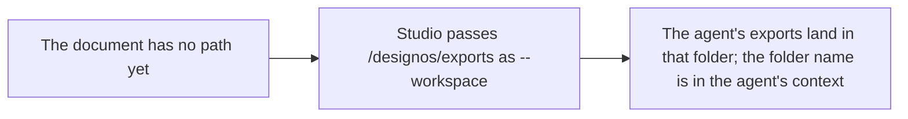
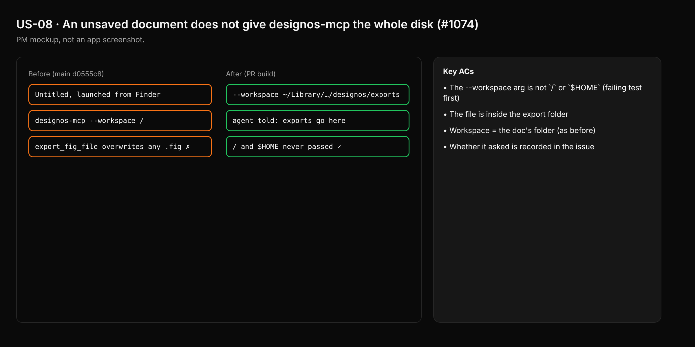

- Issue #1074 · milestone v0.7.2 · code status 25/10: PR #1150 open

## 1. User Story
As a user opening Studio from Finder with an Untitled file, I want designos-mcp's workspace to be a dedicated export folder, not `/`.

## 2. Flow
| Step | Action | Response |
|---|---|---|
| 1 | The document has no path yet | See the related AC |
| 2 | Studio passes `<data dir>/designos/exports` as --workspace | See the related AC |
| 3 | The agent's exports land in that folder; the folder name is in the agent's context | See the related AC |

## 3. Data and rules
- R1. Never pass `/` or `$HOME` as --workspace.
- R2. A doc without a path → a Studio-owned export folder, created if missing.
- R3. If any agent CLI runs MCP tools without asking in Ask mode (check Codex), raise it as a release blocker and tell Jang.

Dependency: PR #1150.

## 4. Acceptance Criteria
| ID | Given | When | Then | Source |
|---|---|---|---|---|
| AC-01 | Studio cwd `/`, doc Untitled | Open an agent tab | The --workspace arg is not `/` or `$HOME` (failing test first) | #1074 |
| AC-02 | Same as above | The agent calls designos_render_png | The file is inside the export folder | #1074 |
| AC-03 | A doc with a path | Open a tab | Workspace = the doc's folder (as before) | regression |
| AC-04 | Codex Ask mode | Call an MCP write tool | Whether it asked is recorded in the issue | R3 |

Test steps: [tests/cases/US-08.md](../tests/cases/US-08.md). For every fix: a failing test first on main `d0555c8`, green after.

## 5. Edge cases
- Doc saved after the tab opened: new tabs use the doc folder; old tabs get a note.
- Export folder not writable: a clear error.
- Doc saved directly in $HOME: don't grant $HOME; use the export folder and tell the agent.

## 6. UI
Reference image (PM mockup, not an app screenshot): 

Real evidence required in the PR: test/terminal output on the PR build.
