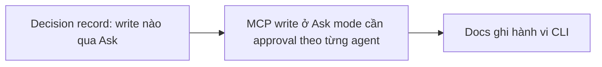

- Issue #1101 · milestone v0.7.2 · trạng thái code 25/10: chưa có PR riêng (PR #1117 chỉ phần input); cần decision record trước

## 1. User Story
Là người dùng chọn Ask mode, tôi muốn mọi ghi qua designos-mcp cần tôi duyệt, và biết rõ CLI headless nằm ngoài gate hay không.

## 2. Flow
| Bước | Hành động | Phản hồi |
|---|---|---|
| 1 | Decision record: write nào qua Ask | Xem AC liên quan |
| 2 | MCP write ở Ask mode cần approval theo từng agent | Xem AC liên quan |
| 3 | Docs ghi hành vi CLI | Xem AC liên quan |

## 3. Dữ liệu và quy tắc
- R1. Decision record liệt kê tool MCP ghi (update_node, save_file, export_fig_file, render_png…) và CLI writes; Jang duyệt (AI không ghi APPROVED).
- R2. Ask: server MCP untrusted, mỗi write hỏi — kiểm cho Claude, Codex, Gemini, Grok, agy.
- R3. CLI headless do user chạy tay: ngoài gate, ghi trong docs; CLI do agent gọi qua DESIGNOS_BIN: theo decision.

Dependency: #930 (card), #924, #1002. QA AI-07 log `v061-ai-mcp-log.json`.

## 4. Acceptance Criteria
| ID | Given | When | Then | Source |
|---|---|---|---|---|
| AC-01 | Decision record | Jang review | Bảng write × gate tồn tại, chờ Jang | #1101 AC1 |
| AC-02 | Ask mode, mỗi agent | Agent gọi update_node | Có prompt trước khi ghi; deny → không đổi (test mỗi agent) | #1101 AC2 |
| AC-03 | Docs | Đọc mục Ask mode | Nêu rõ CLI behaviour | #1101 AC3 |
| AC-04 | Skip mode | MCP write | Không hỏi (như thiết kế) | regression |

Test steps: [tests/cases/US-09.md](../tests/cases/US-09.md). Mỗi fix: test đỏ trước trên main `d0555c8`, xanh sau.

## 5. Edge cases
- Read tool (get_document): không hỏi.
- Agent không hỗ trợ approval MCP: ghi known issue, tắt write tool ở Ask cho agent đó.
- Batch nhiều write: một prompt liệt kê đủ.

## 6. UI
Ảnh tham chiếu (mockup PM, không phải ảnh app): 

Bằng chứng thật bắt buộc trong PR: output test/terminal trên build PR.
