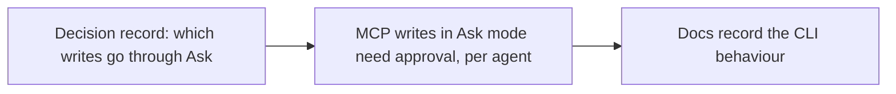

- Issue #1101 · milestone v0.7.2 · code status 25/10: no dedicated PR yet (PR #1117 covers only the input part); needs a decision record first

## 1. User Story
As a user who picks Ask mode, I want every write through designos-mcp to need my approval, and to know clearly whether the headless CLI is outside the gate.

## 2. Flow
| Step | Action | Response |
|---|---|---|
| 1 | Decision record: which writes go through Ask | See the related AC |
| 2 | MCP writes in Ask mode need approval, per agent | See the related AC |
| 3 | Docs record the CLI behaviour | See the related AC |

## 3. Data and rules
- R1. The decision record lists the MCP write tools (update_node, save_file, export_fig_file, render_png…) and CLI writes; Jang approves (AI doesn't write APPROVED).
- R2. Ask: the MCP server is untrusted, every write asks — checked for Claude, Codex, Gemini, Grok, agy.
- R3. Headless CLI run by hand by the user: outside the gate, recorded in docs; CLI called by an agent via DESIGNOS_BIN: per the decision.

Dependency: #930 (card), #924, #1002. QA AI-07 log `v061-ai-mcp-log.json`.

## 4. Acceptance Criteria
| ID | Given | When | Then | Source |
|---|---|---|---|---|
| AC-01 | Decision record | Jang reviews | A write × gate table exists, pending Jang | #1101 AC1 |
| AC-02 | Ask mode, each agent | The agent calls update_node | A prompt before writing; deny → no change (test per agent) | #1101 AC2 |
| AC-03 | Docs | Read the Ask mode section | States the CLI behaviour clearly | #1101 AC3 |
| AC-04 | Skip mode | MCP write | No prompt (by design) | regression |

Test steps: [tests/cases/US-09.md](../tests/cases/US-09.md). For every fix: a failing test first on main `d0555c8`, green after.

## 5. Edge cases
- Read tools (get_document): no prompt.
- An agent without MCP approval support: record a known issue and turn off write tools in Ask for that agent.
- A batch of writes: one prompt listing them all.

## 6. UI
Reference image (PM mockup, not an app screenshot): 

Real evidence required in the PR: test/terminal output on the PR build.
