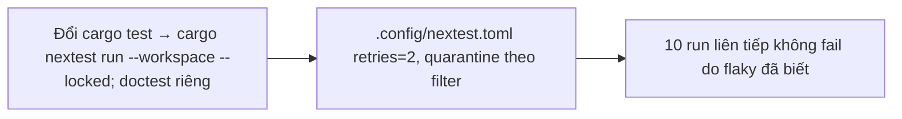

- Issue #1160 · milestone v0.7.2 · trạng thái code 25/10: chưa có PR; đổi workflow cần Jang

## 1. User Story
Là maintainer, tôi muốn test flaky được retry và cách ly có theo dõi, để CI đỏ nghĩa là lỗi thật.

## 2. Flow
| Bước | Hành động | Phản hồi |
|---|---|---|
| 1 | Đổi cargo test → cargo nextest run --workspace --locked; doctest riêng | Xem AC liên quan |
| 2 | `.config/nextest.toml` retries=2, quarantine theo filter | Xem AC liên quan |
| 3 | 10 run liên tiếp không fail do flaky đã biết | Xem AC liên quan |

## 3. Dữ liệu và quy tắc
- 29 cặp fail/pass cùng SHA (15–25/10): macOS 21, Ubuntu 5, Windows 2.
- R1. Số test không giảm (so với cargo test).
- R2. Mỗi test quarantine có issue riêng, danh sách trong #1160.
- R3. Thay đổi `.github/workflows` cần Jang review khi merge. Ngoài scope: Windows optional, path filters, cache. Không giả định ship khi Windows đỏ (quyết định mở của Jang).

Dependency: Jang review workflow. Liên quan #1158.

## 4. Acceptance Criteria
| ID | Given | When | Then | Source |
|---|---|---|---|---|
| AC-01 | PR đổi sang nextest | CI chạy | Số test ≥ lần cargo test gần nhất; thời gian so sánh trong PR | #1160 |
| AC-02 | Test fail lần 1 pass lần 2 | nextest | Đánh dấu `flaky` trong output | #1160 |
| AC-03 | 10 run liên tiếp trên main | CI | Không fail do flaky đã biết | #1160 Done |
| AC-04 | Danh sách quarantine | Đọc issue | Mỗi test có link issue | R2 |

Test steps: [tests/cases/US-10.md](../tests/cases/US-10.md). Mỗi fix: test đỏ trước trên main `d0555c8`, xanh sau.

## 5. Edge cases
- Doctest: chạy bằng cargo test --doc, không mất.
- Test cần chạy tuần tự: test-group trong nextest.
- Retry che lỗi thật: test fail 3/3 vẫn đỏ.

## 6. UI
Ảnh tham chiếu (mockup PM, không phải ảnh app): 

Bằng chứng thật bắt buộc trong PR: output test/terminal trên build PR.
