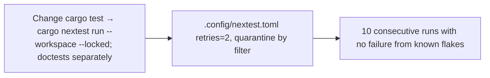

- Issue #1160 · milestone v0.7.2 · code status 25/10: no PR yet; workflow change needs Jang

## 1. User Story
As a maintainer, I want flaky tests retried and quarantined with tracking, so red CI means a real failure.

## 2. Flow
| Step | Action | Response |
|---|---|---|
| 1 | Change cargo test → cargo nextest run --workspace --locked; doctests separately | See the related AC |
| 2 | `.config/nextest.toml` retries=2, quarantine by filter | See the related AC |
| 3 | 10 consecutive runs with no failure from known flakes | See the related AC |

## 3. Data and rules
- 29 fail/pass pairs on the same SHA (15–25/10): macOS 21, Ubuntu 5, Windows 2.
- R1. The test count doesn't drop (vs cargo test).
- R2. Every quarantined test has its own issue, listed in #1160.
- R3. Changes to `.github/workflows` need Jang's review at merge. Out of scope: optional Windows, path filters, cache. Don't assume shipping while Windows is red (an open decision for Jang).

Dependency: Jang reviews the workflow. Related to #1158.

## 4. Acceptance Criteria
| ID | Given | When | Then | Source |
|---|---|---|---|---|
| AC-01 | PR switching to nextest | CI runs | Test count ≥ the latest cargo test run; timing compared in the PR | #1160 |
| AC-02 | A test fails on try 1 and passes on try 2 | nextest | Marked `flaky` in the output | #1160 |
| AC-03 | 10 consecutive runs on main | CI | No failure from known flakes | #1160 Done |
| AC-04 | Quarantine list | Read the issue | Every test has an issue link | R2 |

Test steps: [tests/cases/US-10.md](../tests/cases/US-10.md). For every fix: a failing test first on main `d0555c8`, green after.

## 5. Edge cases
- Doctests: run with cargo test --doc, not lost.
- Tests that must run serially: a test-group in nextest.
- Retry hiding a real failure: a test failing 3/3 stays red.

## 6. UI
Reference image (PM mockup, not an app screenshot): 

Real evidence required in the PR: test/terminal output on the PR build.
