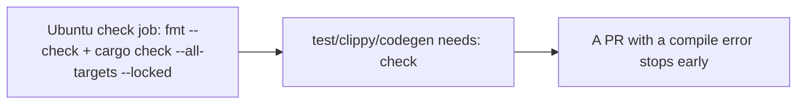

- Issue #1161 · milestone v0.7.2 · code status 25/10: PR #1167 open; workflow change needs Jang

## 1. User Story
As a maintainer, I want compile/fmt errors to stop at a 2-minute job, so we don't spend 3 test jobs × 8 minutes.

## 2. Flow
| Step | Action | Response |
|---|---|---|
| 1 | Ubuntu check job: fmt --check + cargo check --all-targets --locked | See the related AC |
| 2 | test/clippy/codegen needs: check | See the related AC |
| 3 | A PR with a compile error stops early | See the related AC |

## 3. Data and rules
- ~290 failures from code that didn't compile (Clippy 62, Build 146, Rustfmt 26).
- R1. Median of 10 check job runs < 3 minutes.
- R2. Workflow changes need Jang's review.

Dependency: PR #1167, Jang.

## 4. Acceptance Criteria
| ID | Given | When | Then | Source |
|---|---|---|---|---|
| AC-01 | A PR with a deliberate compile error | CI | Stops at check; the matrix doesn't run | #1161 |
| AC-02 | A clean PR | CI | Every job runs | #1161 |
| AC-03 | 10 runs | Measure | Median check < 3 minutes | #1161 Done |

Test steps: [tests/cases/US-11.md](../tests/cases/US-11.md). For every fix: a failing test first on main `d0555c8`, green after.

## 5. Edge cases
- Windows-only errors (cfg): the Ubuntu check doesn't catch them — the matrix still does.
- Empty cache: still measured, recorded separately.

## 6. UI
Reference image (PM mockup, not an app screenshot): 

Real evidence required in the PR: test/terminal output on the PR build.
