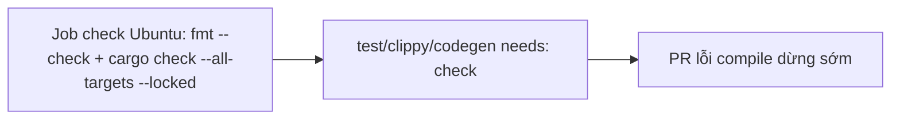

- Issue #1161 · milestone v0.7.2 · trạng thái code 25/10: PR #1167 open; đổi workflow cần Jang

## 1. User Story
Là maintainer, tôi muốn lỗi compile/fmt dừng ở một job 2 phút, để không tốn 3 job test × 8 phút.

## 2. Flow
| Bước | Hành động | Phản hồi |
|---|---|---|
| 1 | Job check Ubuntu: fmt --check + cargo check --all-targets --locked | Xem AC liên quan |
| 2 | test/clippy/codegen needs: check | Xem AC liên quan |
| 3 | PR lỗi compile dừng sớm | Xem AC liên quan |

## 3. Dữ liệu và quy tắc
- ~290 lần fail do code chưa compile (Clippy 62, Build 146, Rustfmt 26).
- R1. Trung vị 10 run job check < 3 phút.
- R2. Thay đổi workflow cần Jang review.

Dependency: PR #1167, Jang.

## 4. Acceptance Criteria
| ID | Given | When | Then | Source |
|---|---|---|---|---|
| AC-01 | PR cố ý lỗi compile | CI | Dừng ở check; matrix không chạy | #1161 |
| AC-02 | PR sạch | CI | Mọi job chạy | #1161 |
| AC-03 | 10 run | Đo | Trung vị check < 3 phút | #1161 Done |

Test steps: [tests/cases/US-11.md](../tests/cases/US-11.md). Mỗi fix: test đỏ trước trên main `d0555c8`, xanh sau.

## 5. Edge cases
- Lỗi chỉ trên Windows (cfg): check Ubuntu không bắt — matrix vẫn bắt.
- Cache trống: vẫn đo, ghi riêng.

## 6. UI
Ảnh tham chiếu (mockup PM, không phải ảnh app): 

Bằng chứng thật bắt buộc trong PR: output test/terminal trên build PR.
