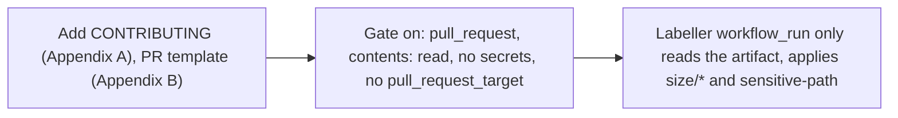

- Issue #1163 · milestone v0.7.2 · code status 25/10: no PR yet; Jang approved the proposal 25/10 22:23 (UTC+7); workflow needs Jang's review

## 1. User Story
As a maintainer receiving PRs from forks, I want the gate to run read-only without secrets and size/sensitive labels applied automatically, so review goes where the risk is.

## 2. Flow
| Step | Action | Response |
|---|---|---|
| 1 | Add CONTRIBUTING (Appendix A), PR template (Appendix B) | See the related AC |
| 2 | Gate `on: pull_request`, contents: read, no secrets, no pull_request_target | See the related AC |
| 3 | Labeller workflow_run only reads the artifact, applies size/* and sensitive-path | See the related AC |

## 3. Data and rules
- R1. The gate never uses `pull_request_target` and has no secrets.
- R2. The labeller doesn't check out PR code.
- R3. size: > 400 lines or > 10 files. Sensitive paths per the proposal (.github, release scripts, designos-mcp, sandbox, agent_permissions, agent_session*, hook_delivery, terminal, vendor).
- R4. `actionlint` clean. Jang reviews the merge. Out of scope: approving fork runs, messaging contributors, closing PRs.

Dependency: pm/contributor-quality-proposal-2026-10-25.md, epic #1105.

## 4. Acceptance Criteria
| ID | Given | When | Then | Source |
|---|---|---|---|---|
| AC-01 | A test PR from a fork | The gate runs | Permissions read-only, no secrets in env | #1163 step 2 |
| AC-02 | A PR touching `.github/` | Labeller | sensitive-path label | #1163 step 3 |
| AC-03 | A PR > 400 lines | Labeller | size/* label | #1163 step 4 |
| AC-04 | New workflows | actionlint | Clean | #1163 Done |

Test steps: [tests/cases/US-12.md](../tests/cases/US-12.md). For every fix: a failing test first on main `d0555c8`, green after.

## 5. Edge cases
- A PR of exactly 400 lines: no label.
- Missing artifact (gate failed early): the labeller skips, no error.
- Renaming a sensitive file: still counts.

## 6. UI
Reference image (PM mockup, not an app screenshot): 

Real evidence required in the PR: test/terminal output on the PR build.
