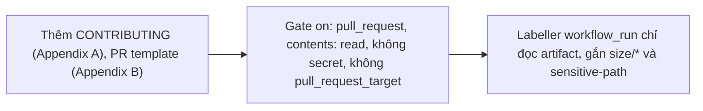

- Issue #1163 · milestone v0.7.2 · trạng thái code 25/10: chưa có PR; Jang đã duyệt proposal 25/10 22:23 (UTC+7); workflow cần Jang review

## 1. User Story
Là maintainer nhận PR từ fork, tôi muốn gate chạy read-only không secret và nhãn size/sensitive tự gắn, để review đúng chỗ rủi ro.

## 2. Flow
| Bước | Hành động | Phản hồi |
|---|---|---|
| 1 | Thêm CONTRIBUTING (Appendix A), PR template (Appendix B) | Xem AC liên quan |
| 2 | Gate `on: pull_request`, contents: read, không secret, không pull_request_target | Xem AC liên quan |
| 3 | Labeller workflow_run chỉ đọc artifact, gắn size/* và sensitive-path | Xem AC liên quan |

## 3. Dữ liệu và quy tắc
- R1. Gate không bao giờ dùng `pull_request_target`, không secret.
- R2. Labeller không checkout code PR.
- R3. size: > 400 dòng hoặc > 10 file. sensitive paths theo proposal (.github, release scripts, designos-mcp, sandbox, agent_permissions, agent_session*, hook_delivery, terminal, vendor).
- R4. `actionlint` sạch. Jang review merge. Ngoài scope: duyệt fork run, nhắn contributor, đóng PR.

Dependency: pm/contributor-quality-proposal-2026-10-25.md, epic #1105.

## 4. Acceptance Criteria
| ID | Given | When | Then | Source |
|---|---|---|---|---|
| AC-01 | PR test từ fork | Gate chạy | permissions read-only, env không có secret | #1163 step 2 |
| AC-02 | PR chạm `.github/` | Labeller | Nhãn sensitive-path | #1163 step 3 |
| AC-03 | PR > 400 dòng | Labeller | Nhãn size/* | #1163 step 4 |
| AC-04 | Workflow mới | actionlint | Sạch | #1163 Done |

Test steps: [tests/cases/US-12.md](../tests/cases/US-12.md). Mỗi fix: test đỏ trước trên main `d0555c8`, xanh sau.

## 5. Edge cases
- PR vừa đúng 400 dòng: không gắn.
- Artifact thiếu (gate fail sớm): labeller bỏ qua, không lỗi.
- Rename file sensitive: vẫn tính.

## 6. UI
Ảnh tham chiếu (mockup PM, không phải ảnh app): 

Bằng chứng thật bắt buộc trong PR: output test/terminal trên build PR.
