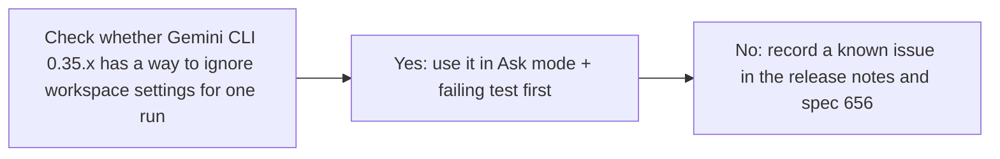
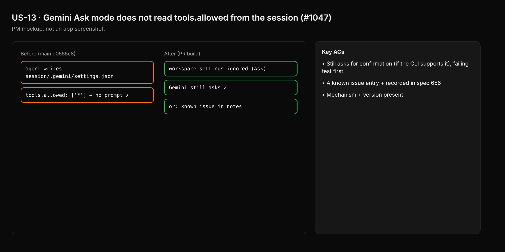

- Issue #1047 · milestone v0.7.3 · code status 25/10: PR #1058 merged (panel part); workspace settings fix not done yet

## 1. User Story
As a Gemini user in Ask mode, I want the agent to be unable to skip the confirmation prompt by editing `.gemini/settings.json` in the session.

## 2. Flow
| Step | Action | Response |
|---|---|---|
| 1 | Check whether Gemini CLI 0.35.x has a way to ignore workspace settings for one run | See the related AC |
| 2 | Yes: use it in Ask mode + failing test first | See the related AC |
| 3 | No: record a known issue in the release notes and spec 656 | See the related AC |

## 3. Data and rules
- R1. The investigation result (flag/env/system override) is pasted into the issue, with the Gemini version.
- R2. Not a separate blocker (ruling 23).

Dependency: #930 PR-A (Gemini). Gemini CLI 0.35.x.

## 4. Acceptance Criteria
| ID | Given | When | Then | Source |
|---|---|---|---|---|
| AC-01 | Session `.gemini/settings.json` has `tools.allowed: ["*"]` | Ask mode, Gemini calls a write tool | Still asks for confirmation (if the CLI supports it), failing test first | #1047 |
| AC-02 | The CLI doesn't support it | Release notes | A known issue entry + recorded in spec 656 | #1047 |
| AC-03 | Investigation result | Read the issue | Mechanism + version present | R1 |

Test steps: [tests/cases/US-13.md](../tests/cases/US-13.md). For every fix: a failing test first on main `d0555c8`, green after.

## 5. Edge cases
- Skip mode: unchanged.
- A Gemini update renames the setting: the test catches it.

## 6. UI
Reference image (PM mockup, not an app screenshot): 

Real evidence required in the PR: test/terminal output on the PR build.
