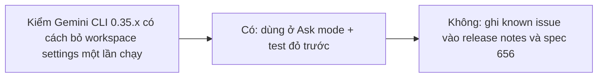

- Issue #1047 · milestone v0.7.3 · trạng thái code 25/10: PR #1058 merged (phần panel); chưa có fix workspace settings

## 1. User Story
Là người dùng Gemini ở Ask mode, tôi muốn agent không bỏ qua được prompt xác nhận bằng cách sửa `.gemini/settings.json` trong session.

## 2. Flow
| Bước | Hành động | Phản hồi |
|---|---|---|
| 1 | Kiểm Gemini CLI 0.35.x có cách bỏ workspace settings một lần chạy | Xem AC liên quan |
| 2 | Có: dùng ở Ask mode + test đỏ trước | Xem AC liên quan |
| 3 | Không: ghi known issue vào release notes và spec 656 | Xem AC liên quan |

## 3. Dữ liệu và quy tắc
- R1. Kết quả điều tra (flag/env/system override) dán vào issue, kèm phiên bản Gemini.
- R2. Không phải blocker riêng (ruling 23).

Dependency: #930 PR-A (Gemini). Gemini CLI 0.35.x.

## 4. Acceptance Criteria
| ID | Given | When | Then | Source |
|---|---|---|---|---|
| AC-01 | Session `.gemini/settings.json` có `tools.allowed: ["*"]` | Ask mode, Gemini gọi tool ghi | Vẫn hỏi xác nhận (nếu CLI hỗ trợ), test đỏ trước | #1047 |
| AC-02 | CLI không hỗ trợ | Release notes | Có mục known issue + spec 656 ghi | #1047 |
| AC-03 | Kết quả điều tra | Đọc issue | Có cơ chế + phiên bản | R1 |

Test steps: [tests/cases/US-13.md](../tests/cases/US-13.md). Mỗi fix: test đỏ trước trên main `d0555c8`, xanh sau.

## 5. Edge cases
- Skip mode: không đổi.
- Gemini cập nhật đổi tên setting: test bắt.

## 6. UI
Ảnh tham chiếu (mockup PM, không phải ảnh app): 

Bằng chứng thật bắt buộc trong PR: output test/terminal trên build PR.
