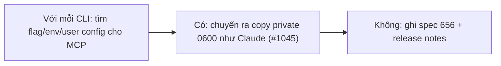

- Issue #1048 · milestone v0.7.3 · trạng thái code 25/10: PR #1078 merged (read-back Grok/agy); chưa chuyển config ra ngoài session

## 1. User Story
Là người dùng, tôi muốn agy, Gemini, Grok khởi động MCP server từ config ngoài session folder, để agent không chèn được lệnh chạy ngoài sandbox.

## 2. Flow
| Bước | Hành động | Phản hồi |
|---|---|---|
| 1 | Với mỗi CLI: tìm flag/env/user config cho MCP | Xem AC liên quan |
| 2 | Có: chuyển ra copy private 0600 như Claude (#1045) | Xem AC liên quan |
| 3 | Không: ghi spec 656 + release notes | Xem AC liên quan |

## 3. Dữ liệu và quy tắc
| CLI | File hiện tại |
|---|---|
| Antigravity | `<session>/.agents/plugins/designos/mcp_config.json` |
| Gemini | `<session>/.gemini/settings.json` |
| Grok | `<session>/.grok/` TOML |
- R1. Ask mode trước. Ruling 24.

Dependency: PR #1045 (Claude), #1078, #1069.

## 4. Acceptance Criteria
| ID | Given | When | Then | Source |
|---|---|---|---|---|
| AC-01 | Mỗi CLI | Điều tra | Bảng có/không + cơ chế dán vào issue | #1048 |
| AC-02 | CLI hỗ trợ đường ngoài | Agent sửa copy session thêm server giả | Server giả không chạy (test đỏ trước) | #1048 |
| AC-03 | CLI không hỗ trợ | Release notes | Known issue + spec 656 | #1048 |

Test steps: [tests/cases/US-14.md](../tests/cases/US-14.md). Mỗi fix: test đỏ trước trên main `d0555c8`, xanh sau.

## 5. Edge cases
- Rewrite thất bại: như #1069 (không khởi động).
- CLI cập nhật thêm flag: mở lại.

## 6. UI
Ảnh tham chiếu (mockup PM, không phải ảnh app): 

Bằng chứng thật bắt buộc trong PR: output test/terminal trên build PR.
