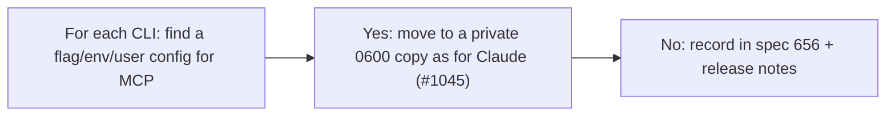

- Issue #1048 · milestone v0.7.3 · code status 25/10: PR #1078 merged (Grok/agy read-back); config not yet moved out of the session

## 1. User Story
As a user, I want agy, Gemini and Grok to start MCP servers from config outside the session folder, so an agent can't inject a command that runs outside the sandbox.

## 2. Flow
| Step | Action | Response |
|---|---|---|
| 1 | For each CLI: find a flag/env/user config for MCP | See the related AC |
| 2 | Yes: move to a private 0600 copy as for Claude (#1045) | See the related AC |
| 3 | No: record in spec 656 + release notes | See the related AC |

## 3. Data and rules
| CLI | Current file |
|---|---|
| Antigravity | `<session>/.agents/plugins/designos/mcp_config.json` |
| Gemini | `<session>/.gemini/settings.json` |
| Grok | `<session>/.grok/` TOML |
- R1. Ask mode first. Ruling 24.

Dependency: PR #1045 (Claude), #1078, #1069.

## 4. Acceptance Criteria
| ID | Given | When | Then | Source |
|---|---|---|---|---|
| AC-01 | Each CLI | Investigate | A yes/no table + mechanism pasted into the issue | #1048 |
| AC-02 | A CLI that supports an outside path | The agent edits the session copy to add a fake server | The fake server doesn't run (failing test first) | #1048 |
| AC-03 | A CLI that doesn't support it | Release notes | Known issue + spec 656 | #1048 |

Test steps: [tests/cases/US-14.md](../tests/cases/US-14.md). For every fix: a failing test first on main `d0555c8`, green after.

## 5. Edge cases
- Rewrite fails: as in #1069 (don't start).
- A CLI update adds a flag: reopen.

## 6. UI
Reference image (PM mockup, not an app screenshot): 

Real evidence required in the PR: test/terminal output on the PR build.
